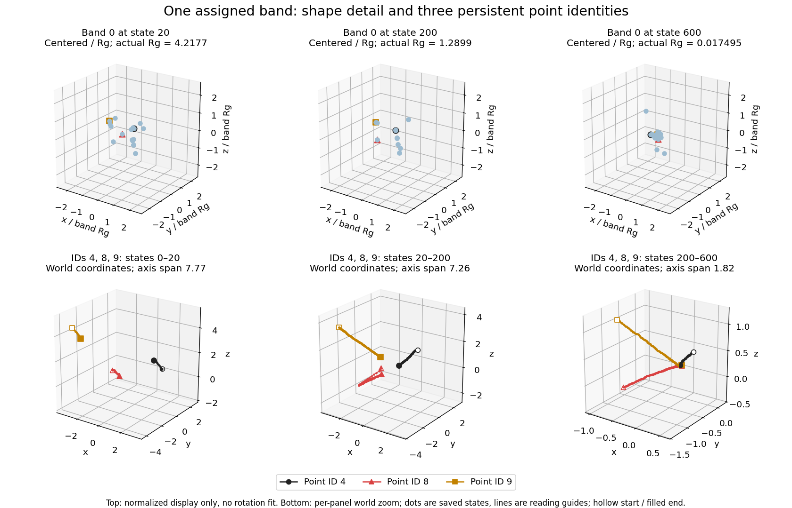
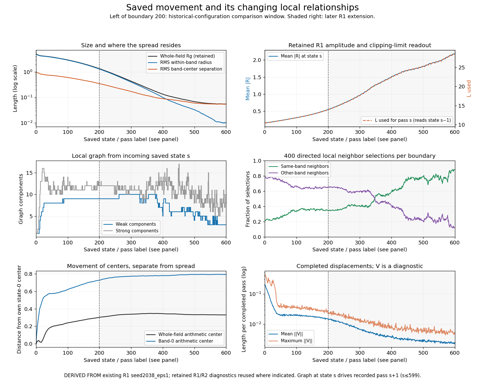

# Movement in the saved Tower II path

All observations below concern the single existing R1 `seed2038_eps1` record. The figures are **new passive renderings of reproduced coordinates**. The historical CSV supports the aggregate comparison at state 200; it does not supply these coordinates. No new state updates or RNG draws were performed.

## Reading the geometry

A stable point ID is its array row, 0–79. Its assigned band is fixed. A local graph edge i→j means that row i selected j as one of five neighbors. Information in the exchange term is read from j by i; the drawn edge convention is a bookkeeping convention. A weak component connects points when edge direction is ignored; a strong component requires directed reachability in both directions. These are local-neighbor relations only: band-wide fusion can couple points across those components.

Graphs here use the original distance/sort selection on fixed saved positions. At incoming state s≤599 the graph drives recorded pass s+1. State-200 graph descriptions therefore also describe the input to **R1 extension pass 201**, not an additional historical update. No graph is claimed for an executed pass 601.

For arithmetic whole-field center mu and band centers mu_b, define

\[
R_g^2=\frac1N\sum_i\|X_i-\mu\|^2,
\quad W=\sum_b\frac{n_b}{N}\frac1{n_b}\sum_{i\in b}\|X_i-\mu_b\|^2,
\quad B=\sum_b\frac{n_b}{N}\|\mu_b-\mu\|^2.
\]

Thus Rg²=W+B. W is within-band spread and B is between-band-center spread; neither is physical energy. Arithmetic centers here are descriptive and differ from the resonance-weighted fusion centers in the update. The ordinary variance identity is also used in prior R3; SIM06 applies it to the selected fixed coordinates without developing a new theorem. Numerical residual against reused Rg² is at most 1.09×10^−14.

Whole-field Rg and mean |R| reuse retained R1 diagnostics, with state 0 from the identical R2 baseline summary. Band geometry, graph descriptions, stable-ID selections and displacement summaries are new passive measurements, labeled in [inspection_summary.json](derived/inspection_summary.json).

| Saved state | Whole Rg | Within-band W | Between-centers B | Mean absolute R |
|---:|---:|---:|---:|---:|
| 0 | 5.2615661 | 26.6382454 | 1.04583223 | .151692819 |
| 20 | 4.2927015 | 17.7685274 | .658758847 | .181526538 |
| 100 | 2.9921807 | 8.58292371 | .370221670 | .312701154 |
| 200 | 1.3528301 | 1.70821443 | .121934728 | .548983269 |
| 400, R1 extension | .13450575 | .0100351822 | .00805661328 | 1.50945602 |
| 600, R1 extension | .05499544 | .000101208944 | .00292328954 | 2.18225233 |

Early spread mostly lies inside the assigned bands. Late spread mostly lies between their arithmetic centers. Both contributions have fallen in absolute size: their change in relative importance is not evidence of a growing physical separation.

**Figure 1.** States 0,20,100,200,400,600; all 80 saved points, color by assigned band, identical [−5.5,5.5] limits on every axis, equal spatial aspect and fixed camera. Markers hide small separations at late times. The drawing supplies neither a unique solid nor proof of exact point coincidence. Data: X.npy, band_id.npy; displayed Rg from derived/geometry.csv. Exact plotting specification is in [FIGURE_REGISTER.json](FIGURE_REGISTER.json).

## Episode 1 — early gathering into mixed groups, states 0–20

The local graph starts as one weak/strong component. It first splits into two weak components at incoming state 10, four at 12, five at 14 and six at 17. At state 20 the six weak components have **14,6,10,8,10,32** members, and every one contains points from all four assigned bands. This is a spatial/local-neighbor grouping, not the construction of four band towers.

Use stable IDs **4,8,9**, the three lowest IDs in band 0; they were chosen by identity order, not fitted to an outcome. At state 0 their neighbor sets are:

- ID 4: {29,35,40,48,71}, all from other bands.
- ID 8: {23,53,60,65,78}, all from other bands.
- ID 9: {13,59,64,72,73}, all from other bands.

At state 20, ID 4 belongs to the eight-point weak component {4,34,35,40,41,42,58,71}, with band counts [2,1,3,2]. IDs 8 and 9 are in the 32-point component, not ID 4's component. Yet all three still participate in the same **band-0 fusion center**, as do their other 17 band members. The source therefore has an explicit interaction that bridges the local graph split.

During these 20 updates, whole-field Rg falls 5.261566→4.292702. Band-0 Rg falls 5.114514→4.217705, while its center moves .498038 from its initial location; the whole-field center moves only .0367702. Those are different motions. The first-lock observer records all four bands by pass 7, **before** the first local graph split at state 10. “Lock” does not mean positions have stopped or spatial groups have formed.

## Episode 2 — groups persist while band spread contracts, states 20–200

Whole-field Rg falls from 4.292702 to 1.352830; band-0 Rg falls from 4.217705 to 1.289888. Band 0's center moves another .323927 between the two endpoints. The three selected IDs retain identity but change relative distances and location; this is not one rigid group translating together.

At state 50 there are eight weak local components. At state 100 and state 200 there are nine. At state 200, band 0's induced local graph alone has **nine** weak pieces; a single band remains spread across local neighborhoods. Of the 400 directed selections, 138 are same-band and 262 cross-band. For example, ID 4 selects {34,35,41,58,71}, containing only one other band-0 point; ID 8 selects {10,15,33,47,60}, again only one band-0 neighbor. ID 9 selects {13,55,57,64,72}, with two band-0 neighbors. See [selected_point_neighbors.csv](derived/selected_point_neighbors.csv) and [graph_memberships.json](derived/graph_memberships.json).

The historical epsilon=1 aggregate row ends at this boundary, with mean |R|=.5489832686504329. It cannot independently establish the intervening local groups; those are observations of the later R1 reproduction. The mean completed point displacement is still .0144032 at pass 200. End-of-window compaction is not rest.

**Figure 2.** Top: all 20 band-0 IDs at states 20,200,600, centered on that band's arithmetic center and divided by its own current Rg. Fixed normalized limits ±2.708686… contain every point; equal aspect, no rotation fitted. This is a display transform only. Actual radii are printed, so the comparable drawn sizes do not conceal contraction. Black circle, red triangle and gold square identify IDs 4,8,9 throughout. Lower views connect those three IDs' consecutive saved coordinates over 0–20,20–200,200–600. Dots are saved states and lines are reading guides, not newly integrated or interpolated states. Each lower panel has its own disclosed **world-coordinate** scale; equal axis aspect is retained. Hollow markers start a window and filled markers end it. The 200–600 window is wholly R1 extension evidence. All coordinates and limits are supplied with the package.

## Episode 3 — later concentration with continuing motion, states 200–600

This entire episode is the **existing R1 extension**, not the original 200-pass evidence. Whole-field Rg falls 1.352830→.0549954. Band-0 Rg falls 1.289888→.0174951 while that band's center moves only .0966780 between the endpoints. The whole-field center moves .0343137. Much of the visible change is concentration around moving centers rather than wholesale translation.

The local graph does not preserve the original component layout. It reaches ten weak components in parts of the extension, then reorganizes repeatedly. At incoming state **599**, used for pass **600**, its three weak components have counts **41,22,17** and band-count vectors **[1,20,0,20]**, **[2,0,20,0]**, **[17,0,0,0]**. The exact membership is in graph_memberships.json. All 20 members of bands 1 and 3 share a local component; three band-0 members lie outside the 17-point band-0 component. Thus four compact assigned bands still do not imply four local components or isolation of every band.

The local inputs for selected IDs are now all same-band: ID 4 selects {8,11,12,17,67}; ID 8 selects {9,11,12,45,57}; ID 9 selects {8,45,55,57,70}. Same-band selections rise to 353/400 at this incoming boundary, but 47 cross-band selections remain. This does not remove band-wide fusion across the three local components.

During completed passes 501–600, the mean point displacement stays between .00225759 and .00309875. At pass 600 the mean is .00252415 and the maximum .00468384. Movement persists beneath world-scale marker overlap. The finite saved path supplies no proof of eventual exact coincidence, permanent component membership or a stable asymptotic solid.

**Figure 3.** Boundary 200 separates the comparison window from shaded R1 extension. Top left compares whole Rg, sqrt(W), sqrt(B); their squares, not their displayed radii, add. Top right reuses mean |R| and L_used with distinct labeled axes; L for pass s reads state s−1. Their near overlap follows the prescribed readout, not two independently observed oscillators. Middle panels report local graph components and same/cross-band edge fractions for incoming states 0–599. Bottom panels distinguish center displacement from completed point displacement. Data: [geometry.csv](derived/geometry.csv), [band_geometry.csv](derived/band_geometry.csv), [graph_boundaries.csv](derived/graph_boundaries.csv).

## Mechanisms and what these observations cannot isolate

As X changes, the five-neighbor selections and inverse-distance weights change. Assigned frequencies stay fixed, but the frequency-weighted exchange acts on different neighbors. Changing resonance affects the band centers' weights and signed fusion displacements. These operations can alter the next geometry and hence later neighbor selection. H(p), the assigned-frequency sine schedules and the noise standard deviation remain prescribed; the actual positional noise is the already saved realization.

The graphs and pictures locate that feedback; they do not measure each term's causal necessity. The earlier R2 controls show that removing additional mixing largely removes net amplification in its paired settings while compaction remains. Its stage budgets and R3's conditional centroid results help distinguish center motion from internal contraction, but no fresh ablation was made here. Even a component with no local edges to another component can interact through common band membership. The component plots therefore do not show fully isolated physical systems.

All original IDs remain present. Band frequencies are assigned scalars, not 3D trajectories or measured phases. Projected crossings, overlapping markers and normalized shape views must not be read as collisions, paths followed in another point's wake, a named polyhedron or a newly discovered force. Such claims are neither required nor established by these records.
