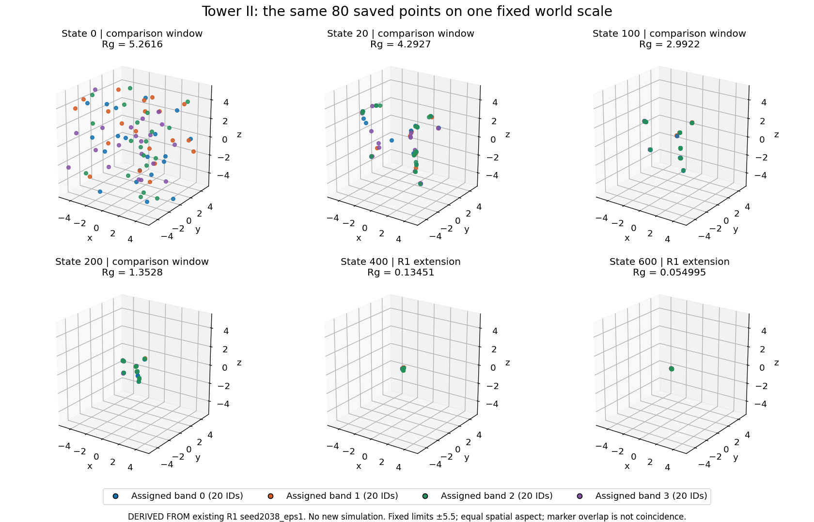

# Tower II — what the old simulation actually does

Hilmir: this program starts with 80 points scattered in three-dimensional space. Each point has a changing number called resonance and a permanent band label. There are four labels, with 20 points each. A label does not initially put its points together: points of every color are scattered throughout the same space.

On each pass, a point moves toward its nearby neighbors. Its resonance changes through exchanges with those neighbors, prescribed frequency terms and the time-dependent H schedule. The program then moves each point toward a center calculated from **all points with its band label**, even when they belong to different local groups. Finally it applies a bound to resonance and adds a small positional random displacement. The saved velocity is the displacement just completed; it is not momentum carried into the next movement.

The surviving record makes this construction much easier to see. Points gather into local groups containing several colors. Those groups continue to move and shrink. Later in the already existing replay, points of the same band become much more concentrated, but four band labels still do not mean four separate local groups. At the incoming boundary for pass 600, the local graph has three weak components; one contains all of bands 1 and 3 plus one point of band 0. Other band-0 points occupy the other two components. The labels and local relationships are different structures.

“Breathing” has a narrower role than the historical explanation suggested. The code recalculates a **resonance clipping limit** from the incoming mean resonance. This limit is neither a spatial container nor an independent oscillator. The earlier R1 study already established that clipping was inactive throughout this selected trajectory and its paired control. We did not rerun that test. The old report's period of 150 passes came from the first nonzero bin of a 150-sample spectrum; it does not establish a self-sustaining heartbeat.

## What evidence is being shown

| Evidence class | What survives and what this package does with it |
|---|---|
| **ORIGINAL SOURCE** | Complete, unchanged 842-line `srg_golden_tower_II.py`, 34,980 bytes, matching the work-order hash. Read in full, including all five drivers and observers. |
| **ORIGINAL AGGREGATE EVIDENCE** | The unchanged seven-row `self_coupled_breathing.csv` and original explanatory note. The selected row is epsilon=1, seed 2038, 80 points, four bands, 200 passes. |
| **EXISTING REPRODUCTION** | R1 `RUN_01/seed2038_eps1`: 601 saved X/V/R boundaries, states 0–600. The selected configuration matches the historical driver. States 0–200 are the comparison window; 201–600 are a later R1 extension. No original full coordinate history is asserted. |
| **NEW PASSIVE DERIVATION / RENDERING** | Geometry, graph descriptions and three static figures calculated from those saved records. No point was advanced; no random number was drawn. |
| **RETAINED PRIOR RESULTS** | R1/R2 findings and R3's explicitly review-status report, with their original qualifiers. Prior control trajectories and scientific checkers were not rerun. |

These are new pictures of an existing reproduced trajectory, not recovered historical pictures. At this scale the late markers overlap. That does not mean the 80 identities have fused into one point.

## Read the package

1. [CONSTRUCTION.md](CONSTRUCTION.md) explains one pass in ordinary language and exact equations, then maps the complete source and drivers.
2. [ORIGINAL_EVIDENCE_AND_EXISTING_REPLAY.md](ORIGINAL_EVIDENCE_AND_EXISTING_REPLAY.md) separates the original CSV and narrative from later R1 records and prior explanations.
3. [MOTION_AND_GEOMETRY.md](MOTION_AND_GEOMETRY.md) gives three episodes, stable IDs, figures, graph membership and measurements.
4. [MODEL_RELATIONSHIPS.md](MODEL_RELATIONSHIPS.md) compares mechanisms and identifies what remains historically unresolved.
5. [RECORD_SELECTION.md](RECORD_SELECTION.md) gives exact record locations, indexing, reproduction commands for passive inspection, and preservation limits.

The strongest new descriptive result is the distinction between **assigned bands, local graph groups, center movement and internal spread** along the same saved path. Whole-field radius falls from 5.261566 at state 0 to 1.352830 at state 200, then to 0.0549954 at state 600. At the end, most remaining variance is between band centers, while motion remains nonzero. These finite observations establish neither an infinite-time limit nor physical energy, gravity, a unique solid or universal oscillation.

Tower I's narrower variant is adequately distinguished by the current source comparison. Universe/condensate's in-place local fusion and BreathingField's field-merger operation remain genuinely different construction questions; this study does not settle them. Any decision to investigate them belongs to GPT and Hilmir after this review.

**Status: completed construction checkpoint, for GPT and Hilmir review. Zero new state updates; zero RNG draws; no historical imports or prior scientific checker reruns; no Git writes, kernel changes, ledger edits or publication. Stop here. No next engine or Volume III work is authorized by this delivery.**
