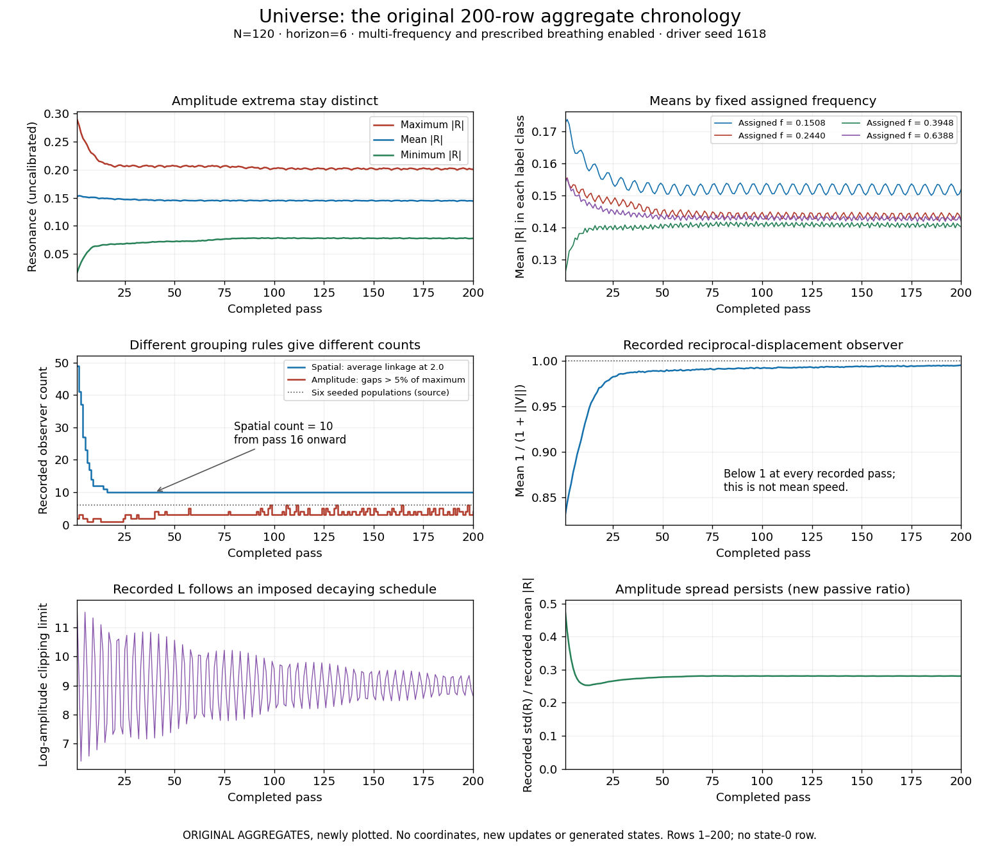
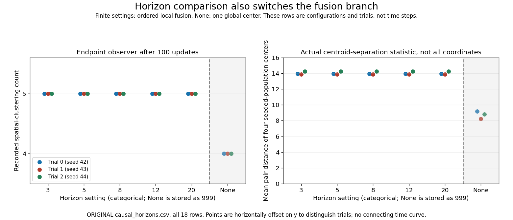

# What the surviving movement evidence supports

The original source tells us **how** points move. The retained data tell us about some aggregate consequences. They do not provide coordinates, full velocities, frequency membership per ID, graph edges or successive local centers. This distinction is the main limitation of the present study, not a reason to invent a picture.

The primary record is [full_universe.csv](original/full_universe.csv), attributed to S:663–758 in [the original source](original/srg_condensate_breaking.py). Its 200 rows represent completed passes 1–200 of the 120-point, horizon-6 setting. It contains no state 0, repeated pass labels or missing rows. Existing source-index checks identified no attributable full Universe trajectory. Therefore no 3D scatterplot, fitted solid, center path, within-group radius, local graph count or point-following episode is supplied.

## Three readable periods in the aggregate record

These are row intervals, not reconstructed point trajectories. Complete selected rows and label changes are retained in [TABLE_INSPECTION.json](derived/TABLE_INSPECTION.json) and [full_universe_selected_rows.csv](derived/full_universe_selected_rows.csv).

| Completed pass / data row | Mean absolute R | R_min / R_max | std(R) / mean absolute R (derived) | Spatial / amplitude-gap counts | Mean GRF |
|---:|---:|---|---:|---|---:|
| 1 | .152135728 | .016266423 / .289449182 | .477005 | 49 / 2 | .830615833 |
| 10 | .150628757 | .063709587 / .224585060 | .255420 | 12 / 2 | .922701780 |
| 20 | .146822502 | .066921251 / .204801852 | .259951 | 10 / 1 | .973228288 |
| 50 | .145393371 | .071984055 / .206548158 | .277551 | 10 / 3 | .988330364 |
| 100 | .144995152 | .077966935 / .202423843 | .280623 | 10 / 3 | .991695015 |
| 150 | .145001316 | .077893178 / .201841789 | .280728 | 10 / 5 | .993791677 |
| 200 | .144070881 | .077696148 / .200645840 | .280754 | 10 / 4 | .994912594 |

**Passes 1–16: fewer groups under the spatial observer.** The recorded average-linkage count falls 49→41→37→27→23→19→17→14→12 at passes 1–9, stays 12 through pass 13, becomes 11 at pass 14 and reaches 10 at pass 16. The movement construction can bring nearby points together, and this count documents a change under its particular threshold. It does not quantify whole-field contraction, tell which IDs joined a group, or prove that populations merged. A count depends on the clustering rule as well as coordinates.

**Passes 17–100: a stable spatial count with changing amplitudes.** The spatial count remains 10, but amplitude-gap counts vary and frequency-label means continue to change. At pass 20 the amplitude-gap count is one even though R_min and R_max are .0669213 and .204802. “One resonance cluster” therefore does not mean exact amplitude equality. Band columns are whole-field means for fixed assigned frequencies, not spatial groups. The maximum-amplitude ID changes from 12 to 83 at pass 15 and subsequently among other IDs. This records a changing winner, not an ID's movement, leadership or travel direction.

**Passes 101–200: no evidence of an exact stopped state.** Spatial count stays 10, while amplitude-gap count ends at four and amplitude spread remains substantial. The last row has R_std=.040448472 and mean |R|=.144070881, so their ratio is .280754; its maximum is not a common resonance value. Mean GRF is below 1 on every saved pass, including .994912594 at pass 200. Since each recorded term is 1/(1+||V_i||), this supports some nonzero completed displacement at each recorded pass, as represented by the observer. It cannot recover the individual displacements, their mean speed, direction or band-center translation. It is not permissible to invert the mean reciprocal as though all speeds were equal.

The selected full record's L_effective values span 6.3965367–11.6712352. The plotted alternating pattern is a recorded, externally prescribed schedule whose deviation from 9 decays; it is not evidence of an independently generated breathing mode. Amplitude curves vary under assigned periodic forcing and changing local interactions; no new spectral attribution or period fit is made.

**Figure 1 — ORIGINAL AGGREGATES, NEW RENDERING.** All rows 1–200 of full_universe.csv. Upper panels show recorded amplitude extrema/mean and frequency-label means. Middle panels show two different grouping observers and the recorded mean reciprocal displacement. Lower panels show recorded L and the new passive ratio R_std/R_mean. The dotted six-population reference comes from the driver, not a recovered clustering measurement. Lines connect supplied samples for reading; no missing state is interpolated or advanced. No spatial units or speeds have been invented. Source columns, row bounds, transforms and pixel size are in [FIGURE_REGISTER.json](FIGURE_REGISTER.json).

## Horizon comparison: real separation information, but no recoverable shape

The supporting horizon table saves actual mean and minimum distances between four arithmetic centers of the original ID populations. It therefore supplies some spatial evidence even though complete coordinates are absent. All finite settings show roughly 14 units mean pair separation at the 100-pass endpoint; None shows roughly 8–9. The average-linkage observer reports five groups in finite settings and four with None. Both observations should be retained positively.

Those four seeded populations, the spatial observer groups and the update's local graph components are three different objects. Neither identical group counts nor similar center distances establishes stable membership or complete dynamical independence. The table's flattened-coordinate “intra spread” is not a centered 3D radius, as explained in [ORIGINAL_EVIDENCE.md](ORIGINAL_EVIDENCE.md).

**Figure 2 — ORIGINAL CONFIGURATION/TRIAL SUMMARIES, NEW RENDERING.** All 18 rows of causal_horizons.csv. Each color is one trial, not one moving point. The x-axis is categorical: the exported sentinel 999 is relabeled None, with no inference of an actual radius 999. Tiny horizontal offsets distinguish trials. The dashed division highlights the source's switch from ordered local fusion to one global center. No time curve connects these settings. Inter-center distances have uncalibrated source coordinate units. The source always selects at most five neighbors; None does not mean all-to-all amplitude exchange, although it does activate a global fusion center.

## What is still missing for the central fusion question

The static source trace proves that a later fusion center reads already changed coordinates when earlier IDs appear in its old neighbor list. It also shows no distance recomputation inside that stage, no distance weights in its centers, direct exclusion of self and fixed Q throughout the loop. It establishes possible ordered dependency, not a measured nonzero ordering effect on this historical realization.

To connect that mechanism to a concrete moving-point episode, we would need at least initial and completed coordinates with fixed IDs/frequencies, incoming adjacency, post-local Y, post-H Q and local-center/fusion-write observations for the selected path. Aggregate entropy, label means, cluster counts and GRF do not uniquely determine them. Even consecutive completed states would not directly reveal every within-pass center without additional records.

No claim is made that the historical program had no interesting motion. Rather, the source and summaries leave its geometry underdetermined. The optional [replay decision note](REPLAY_DECISION_NOTE.md) describes one bounded future way to obtain that missing evidence if GPT and Hilmir approve it. It has not been implemented or executed.
