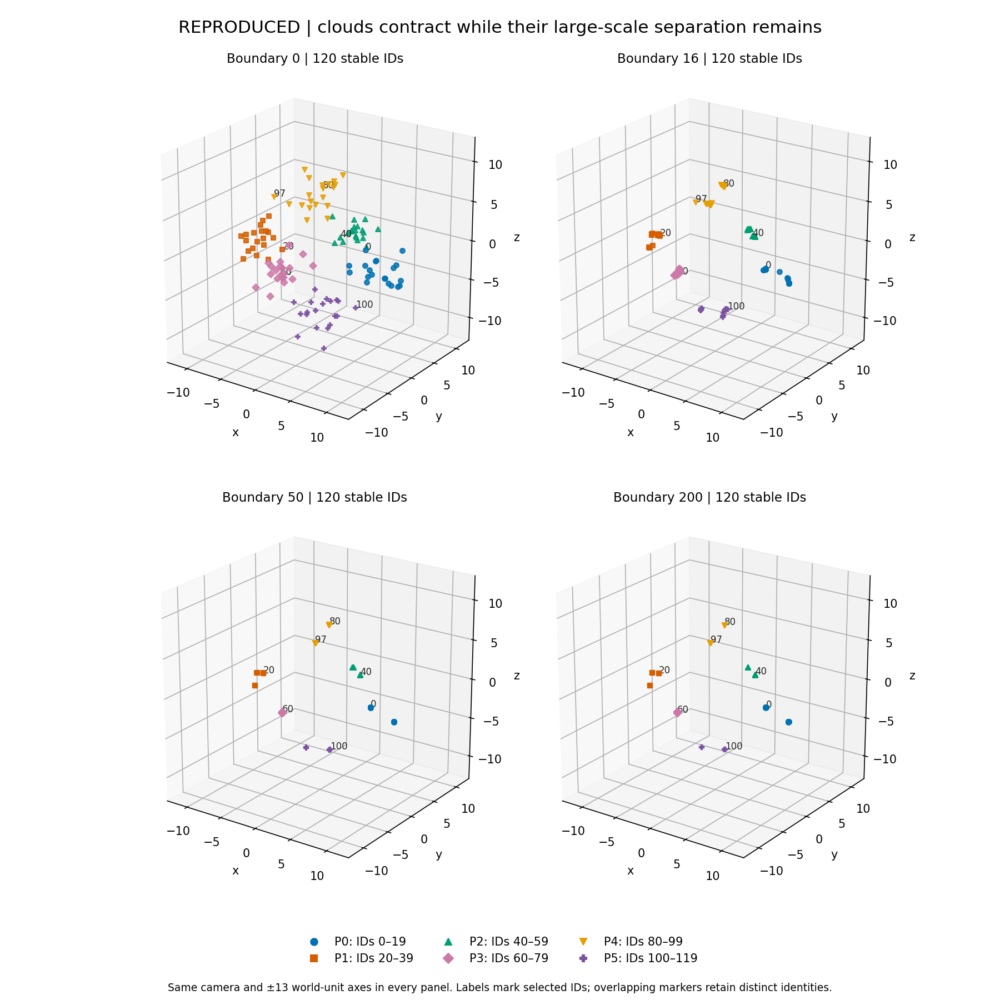

# SIM07 Universe replay — start here, Hilmir

**25 October 2026 · Scientific lead: GPT · Research engineering: Codex · Returned for GPT and Hilmir review**

We can now see what this one original Universe setting makes its points do. The six clouds supplied at the beginning tighten into smaller groupings while staying far apart overall. Their later appearance is nearly stationary at the scale of the whole scene, but the points continue making small movements. Ten groups identified by the original spatial observer have unchanged membership from pass 16 through pass 200. Their nearest-neighbor connections still change. A stable group count, stable membership and zero movement are three different statements; only the first two hold over that later window.

There is also a brief connection between two of the supplied clouds. Point 97 begins near points 34 and 39 from another population. Three directed selection pairs connect these populations during the first eight passes. Those cross-population selections then disappear. Point 97 continues toward the grouping containing its original population; its recorded path is the longest of the 120 points over this replay. This is actual movement from saved states, not a behavior chosen from memory or found by searching seeds.

The ordered fusion is now directly visible too. When a later row calculates its local center, it really does read some coordinates already changed by earlier rows in that pass. At pass 16, row 6 reads the updated coordinates of IDs 2 and 5, while IDs 11, 16 and 18 still have their post-local coordinates. We retain the operands and the resulting center. We have not run a simultaneous or reversed version, so this evidence does not quantify the effect of changing the update order.

## The replay passed both required checks

- **Recording fidelity:** the reference and capture agree bit for bit at all 201 boundaries, including positions, signed amplitudes, displacement arrays, fixed frequencies, configuration and deterministic RNG checkpoints. All original metric rows agree exactly; their two CSV exports are byte-identical.
- **Historical comparison:** all 800 integer cells match exactly, including 200 pass labels. All 2,200 continuous cells pass the frozen tolerance. Of 3,000 total cells, 2,312 are exactly equal after parsing; the other 688 have small nonzero discrepancies. The largest absolute discrepancy is about 1.78×10⁻¹⁵ in entropy. The replay CSV is not byte-identical to the historical CSV.
- **Budget:** exactly two prescribed initializations and 400 updates: reference 200, capture 200. No failed calls, retries, extra seeds or extra settings.

All new coordinates are **REPRODUCED**. Agreement with the old aggregate table supports this reconstruction of the selected implementation, but does not recover the original coordinates, execution environment or historical RNG provenance. The two runs establish recording fidelity for one setting; they are not independent experimental trials.

## Read the evidence

1. [Whole-field snapshots](figures/F01_world_snapshots.png) show the actual positions at boundaries 0, 16, 50 and 200 on identical world scales.
2. [Motion and groups](MOTION_AND_GROUPS.md) explains the six input populations, four assigned frequencies, changing interaction graph and ten observer groups. [Transient contact](figures/F06_transient_cross_population_contact.png) follows IDs 34, 39 and 97.
3. [Ordered fusion trace](ORDERED_FUSION_TRACE.md) identifies the exact earlier writes and later reads, with three recorded examples.
4. [Fidelity and provenance](REPLAY_FIDELITY_AND_PROVENANCE.md) documents extraction, draw order, environment, execution budget and historical comparison.
5. [Verification and limits](VERIFICATION_AND_LIMITS.md) points to the machine-readable checks and preservation records. [Record schema](RECORD_SCHEMA.md) explains every retained array and its indexing.

The signed amplitudes remained positive in the saved boundaries and captured pre-fusion stages. Neither clipping bound activated in any of the 24,000 captured point updates. The prescribed bound still moved, and the original log/exp expression was still evaluated. This finite observation does not establish a physical condensate, an energy minimum or an infinite-time outcome.

The package contains six inspected static figures, their plotted values, complete reference/capture records, actual random returns, source/context copies, code and verification receipts. No animation, PDF or paper was needed. The ZIP's **external** `REVIEW_ZIP_IDENTITY.json` is supplied beside the ZIP, not inside it; the payload manifest excludes itself and the external identity to avoid circular hashing.

**Stopped here.** Protected inputs and the accepted construction are unchanged. No other engine, parameter search, manuscript, ledger, kernel, Git or publication action was undertaken. These results await GPT and Hilmir's scientific review.
