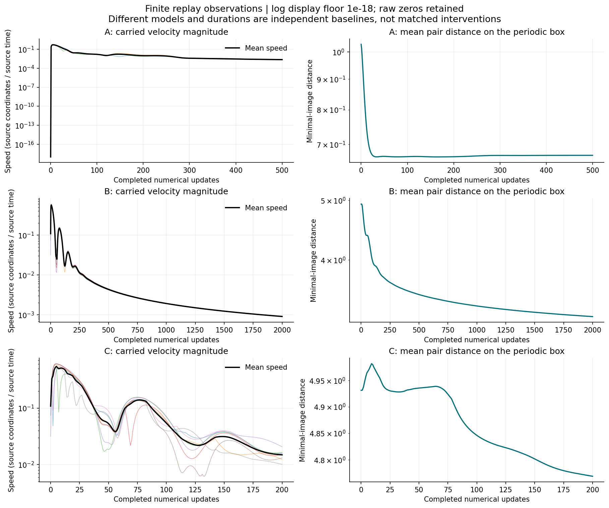
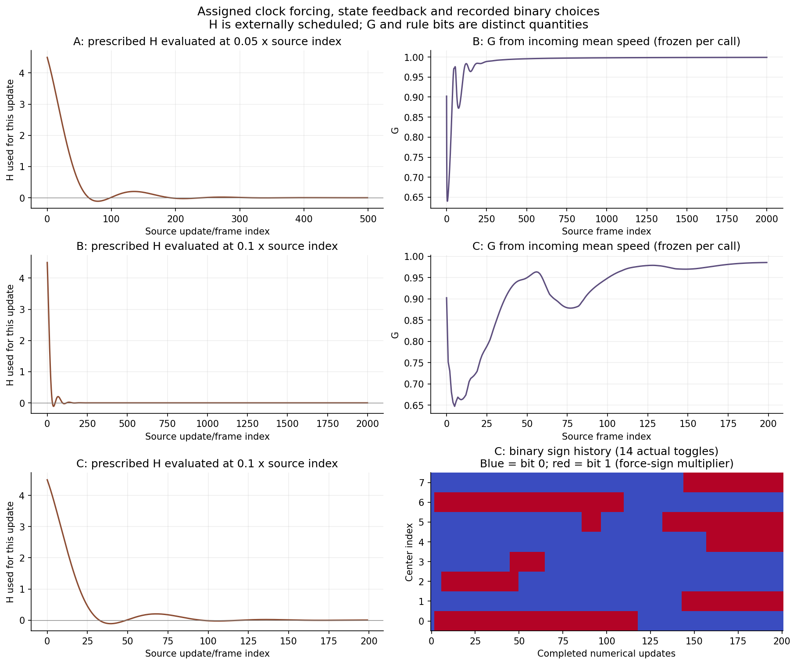
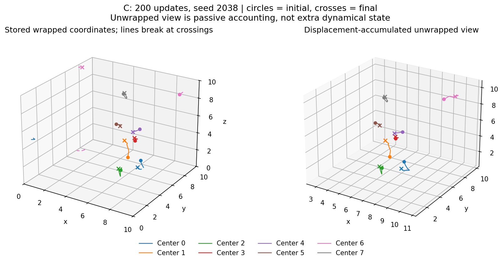

# SRG-SIM01 — Surviving recursive motion simulations

**13 October 2026 · Completed bounded replay · For GPT scientific review**

The three programs produce coupled, state-dependent motion on periodic coordinate boxes. Scheduled forcing decays and changes sign; componentwise damping reduces the velocity presented to it. In the authorized finite runs, speeds decline substantially from their peaks while separated centers continue moving. Engine C produces 14 recorded binary force-sign changes. Its numerous “teleport” reports arise from the displacement observer: no replay displacement exceeds its threshold under the minimal-image convention.

These are source-consistent finite observations, with no established asymptotic attractor or physical interpretation. The missing June toroidal-topology implementation remains a separate unresolved lineage.

## Evidence and source map

R0 §2.2 and §5.1 already identified sequential updates, callback re-entry and the displacement-observer problem. Its source coverage and saved-data records were consulted without repeating the census. The prior TA0 conversation ended with a source gap; no on-disk TA0 report was available. GPT supplied the selection, hashes and passive 1,530-transition checker. This task verified local identities, re-executed that checker, established extraction fidelity and performed the three new replays. Reusing GPT's checker is evidence replication, not an independently designed second implementation.

Historical paths below are relative to SRG_REDISCOVERY/OLD_MATERIAL. Bundle copies retain original bytes and line numbering.

| Engine | Historical path / review copy | Exact source references |
|---|---|---|
| A | Simulations_Trash/Simulations_part_2/recursive_attractor.py / [source_A.py](sources/source_A.py) | Parameters/init 5–11; H 17–27; damping/wrapping 30–35; update 38–59 |
| B | Simulations_Trash/Simulations_part_2/3Dtriangles.py / [source_B.py](sources/source_B.py) | Parameters/init 8–16; helpers 29–51; update 74–96; animation/save 107–119 |
| C | Simulations_Trash/Simulations_part_1/plot_1.py / [source_C.py](sources/source_C.py) | Parameters/init 10–18, 152; helpers 31–71; update 100–126; observers/export 129–147; animation/save 155–167 |

The three source and two CSV hashes match the work order. Full identities are in [INPUTS_BEFORE.json](evidence/INPUTS_BEFORE.json), with preservation results in [FINAL_QA.json](evidence/FINAL_QA.json). The received selection package passed manifest/CRC checks. The larger historical Simulations.zip was not re-audited.

## Actual motion, state and equations

A moves three centers, each in two dimensions, using wrapped pairwise forces. Earlier centers have already moved when later centers calculate their forces. Three centers are not three spatial directions.

B carries eight 3D centers. It aims each toward the arithmetic centroid of the currently stored wrapped positions, recomputing that centroid inside the sequential loop. A common speed feedback reduces forcing at higher incoming mean speed. The displayed tetrahedron vertices are fixed offsets (B 19–26), without independent shape or rotational state.

C adds one carried bit per center. An eligible random draw toggles it before the force is applied. A predefined force-sign choice can therefore persist and switch; the source contains no arbitrary rule-writing mechanism.

Let \(p^{(i)}\) denote positions just before center \(i\) is processed: indices below \(i\) already contain successor positions. Wrapping and damping act componentwise:

\[
\begin{aligned}
H(t)&=2e^{-0.5t}\cos t+e^{-0.3t}\sin t+1.5e^{-0.7t}+e^{-0.4t},\\
D(x)&=\frac{x}{1+\log(1+|x|)},\\
M_L(x)&=((x+L/2)\bmod L)-L/2,\qquad W_L(x)=x\bmod L.
\end{aligned}
\]

The implementation retains NumPy's original log1p, arithmetic grouping, modulo expressions and loop order; these equations express their mathematical meaning.

| Feature | A | B | C |
|---|---|---|---|
| Carried state | \(p,v\in\mathbb R^{3\times2}\) | \(p,v\in\mathbb R^{8\times3}\) | B state plus \(b\in\{0,1\}^{8}\) |
| Initialization, original draw order | \(p=2U-1,\ v=0\) | \(p=10U,\ v=0.2(U'-0.5)\) | B initialization; all bits zero |
| Position representative | \([-1,1)^2\) | \([0,10)^3\) | Same as B |
| Source time | \(t=0.05\,\mathrm{step}\) | \(t=0.1\,\mathrm{frame}\) | Same as B |
| Denominator regularizer | \(10^{-3}\) | \(10^{-2}\) | \(10^{-2}\) |
| Feedback | Wrapped pairwise positions | Current centroid; incoming mean speed | B feedback; carried sign bits |

A processes \(i=0,1,2\), summing \(j\ne i\) in original index order:

\[
F_i=\sum_{j\ne i}\frac{M_2(p_j^{(i)}-p_i^{(i)})}
{\|M_2(p_j^{(i)}-p_i^{(i)})\|+10^{-3}},
\quad
v_i^+=D(v_i+0.05H(t)F_i),
\quad
p_i^+=M_2(p_i^{(i)}+0.05v_i^+).
\]

B/C freeze the common gain once from incoming velocities:

\[
G=\frac{1}{1+\frac18\sum_{j=0}^{7}\|v_j\|}.
\]

Despite its arguments, GRF(positions,t) reads global velocities; neither argument enters its formula. For each \(i=0,\ldots,7\),

\[
c_i=\frac18\sum_jp_j^{(i)},\quad d_i=M_{10}(c_i-p_i^{(i)}),\quad
F_i=\frac{d_i}{\|d_i\|+10^{-2}}H(t)s_i,
\]
\[
v_i^+=D(v_i+0.1F_iG),\qquad
p_i^+=W_{10}(p_i^{(i)}+0.1v_i^+).
\]

B has \(s_i=1\). C tests \(G>0.5\), equivalently incoming mean speed \(<1\). Only with this gate open does it consume one actual scalar np.random.rand() draw for that center. A draw below 0.01 toggles \(b_i\); otherwise it is retained. Then \(s_i=(-1)^{b_i^+}\). Draws follow center order; G is not recomputed within the call. Stored wrapped coordinates determine the centroid; a circular mean would change this program.

For real nonzero \(x\), \(|D(x)|<|x|\), with \(D(0)=0\). This bounds damping, not the complete forced update. Regularization makes a zero-difference force zero. Normalized force terms have norm below one: A has \(\|F_i\|<2\) before H; the B/C velocity increment before damping is bounded by \(0.1|H|G\). Also \(0<G\le1\), and
\[
|H(t)|\le2e^{-0.5t}+e^{-0.3t}+1.5e^{-0.7t}+e^{-0.4t}\quad(t\ge0).
\]
Negative H reverses the nominal force direction even with bit zero. H is externally prescribed clock forcing. Carried memory consists of positions/velocities, plus C's bits and stochastic generator state.

## Fidelity and executed accounting

No historical top-level module was imported. [EXTRACTION_MAP.json](evidence/EXTRACTION_MAP.json) records retained statements and detached hashes. Preparation compared abstract syntax after removing added read-only trace calls and metadata returns. Numerical expressions, helpers and initialization match. GUI, printing, file output and passive history collection were separated.

Exactly **12 preflight full-system calls** covered six observed/unobserved fixture pairs. A/B checked coincident centers and boundary wrapping; C checked boundary wrapping with an actual open-gate toggle and a frozen closed gate. Each pair had bitwise-equal carried state and equal full RNG checkpoint. Traces verified sequential ordering. Energy/detector evaluation preserved carried state and RNG. Equality of all carried inputs establishes equal next states for equal future frame arguments; no additional next-step calls were used.

After that gate passed, exactly **2,700 fresh full-system updates** ran, once per engine:

| Engine | Source indices | Updates / stored states | Supervisor wall time | Recorded peak output bytes |
|---|---|---:|---:|---:|
| A | 0–499 | 500 / 501 | 1.093 s | 151,441 |
| B | 0–1999 | 2,000 / 2,001 | 2.266 s | 1,618,091 |
| C | 0–199 | 200 / 201 | 0.984 s | 242,824 |

All completed with finite position/velocity state. Limits were 120 seconds and 268,435,456 bytes per run; actual output was also far below decimal 256 MB. No restarts, sweeps or continuations occurred. The 1,530 saved-input calculations and subsequent NPZ analysis added no fresh rollout calls. One plot layout correction only reread saved arrays.

Each run independently used np.random.seed(2038), NumPy's legacy global RandomState/MT19937, then exact original initialization. This is a present-day replay seed, not recovered historical metadata. Full initial/final RNG checkpoints and initial states are retained. Execution used Windows CMD, conda activate torment, Python 3.11.15 and NumPy 2.4.4; passive analysis used pandas 3.0.3 and Matplotlib 3.10.9. No dependency installation, network or GUI was used.

## Finite motion and feedback

Distances use minimal-image pair separations on each program's periodic box; they are passive readouts.

| Engine | Peak → final mean speed | Initial → final mean pair distance | Wrapped crossing body-updates |
|---|---:|---:|---:|
| A | 0.506743 → 0.00229166 | 1.029341 → 0.670914 | 1 |
| B | 0.562534 → 0.000911196 | 4.931293 → 3.236646 | 0 |
| C | 0.545645 → 0.0148867 | 4.931293 → 4.769511 | 7 |

A began at zero mean speed; B/C at 0.108235. Mean separation fell between endpoints, but not monotonically throughout the runs. C's maximum pair distance increased from 7.337292 to 7.674373: decreased mean separation does not imply uniform contraction. In B's final 200 updates each center still travelled about 0.0191–0.0194 units despite almost vanished H. Finite visual settling therefore does not establish a stationary or asymptotic attractor.

C's G ranged from 0.646979 to 0.985281; its gate stayed open for all 200 updates. Its 1,600 actual draws caused **14 toggles**, recorded in [switch_events.csv](runs/C/switch_events.csv); final bits were [0,1,0,0,1,1,0,1]. No prescribed-switch outcomes were used. One realization does not empirically certify the switch probability.

[A trajectories](plots/A_trajectories.png) and [B trajectories](plots/B_trajectories.png) use the same start/end markers. Wrapped curves break at crossings; the unwrapped view accumulates minimal-image displacements. Coordinate ranges differ between panels. Raw positions and displacements remain available. Every component of \(dt\,v_i^+\) stayed below half a box, and minimal-image displacement matched \(dt\,v_i^+\) within \(8.89\times10^{-16}\). This justifies the passive lift for these sampled steps.

The different rules and durations are three baselines, not a matched intervention identifying one term's causal contribution.

## Saved logs, clocks and observer provenance

Local copies reproduced GPT's consistency finding in file order, using recorded destination frames and destination bit vectors.

| Saved filename in data/ | Rows / blocks | Adjacent checks | Same / decreasing frame successions | Bit changes |
|---|---:|---:|---:|---:|
| PLOT_1_tetrahedral_states_20250712_015421.csv | 8,736 / 1,092 | 1,091 | 6 / 5 | 79 |
| tetrahedral_states_20250712_015647.csv | 3,520 / 440 | 439 | 3 / 2 | 33 |

Maximum velocity residual was \(1.1102230246251565\times10^{-16}\) in both; position residuals were \(8.8818\times10^{-16}\) and zero. G/energy residuals were zero. GPT's second position residual was \(4.44\times10^{-16}\) with different NumPy/pandas versions. This is numerical consistency conditional on saved outcomes, not recovered RNG history or exact-real equality. Duplicate aliases were not counted as separate runs.

Three clocks remain distinct: actual calls, supplied frame/step argument and movie playback. Old C Step labels repeatedly traverse 0–199 while state continues evolving. Since H depends on the supplied frame, decreasing labels also reset its forcing argument. This is consistent with callback re-entry; exact save/show/repeat invocation history remains unknown. Sorting rows by Step would destroy evolution order. B's 50-ms display interval and 60-fps movie, and C's 50-ms interval and 20-fps movie, do not redefine DT. The fresh harness schedules each index once.

C's source-defined energy is \(E=\tfrac12\sum_i\|v_i\|^2\), with zero potential energy explicitly a placeholder. It is computed after the update; saved G describes the incoming state. Neither energy nor detector feeds motion. C's replay energy changed from 0.05157145 initially (passively evaluated) to 0.0009214795 finally; no conservation or physical calibration follows.

The source detector (C 64–71) evaluates
\[
J_i=\|W_{10}(p_i^+-p_i)\|,\qquad J_i>1.
\]
For a small negative component, \(W_{10}(-\epsilon)=10-\epsilon\). Ordinary small movements can therefore be reported as large jumps. The detector remained unchanged:

| Record | Source detector body-events | Minimal-image steps \(>1\) | Largest minimal-image step |
|---|---:|---:|---:|
| Fresh C | 1,509 | 0 | 0.060998 |
| First old CSV, adjacent blocks | 8,151 | 0 | 0.061532 |
| Second old CSV, adjacent blocks | 3,129 | 0 | 0.060381 |

Old counts exclude the first block without a recorded predecessor. They are evaluated observer results, not recovered console transcripts. Fresh C's seven coordinate crossings are a separate count.

## Disposition and review materials

**Recommend C as the existing base for further SRG work:** its complete carried state, explicit feedback, binary choices and source-defined readouts are traceable to substantial saved records. A remains a minimal reference and B a deterministic feedback reference. This recommendation starts no new task.

The June Phases 1–3 producer remains unidentified. The separate curvature CSV's Adjusted_DT producer remains unresolved and was not inserted here. A/B/C neither compute pi*e*phi nor use a constant/gamma seed or Tri-Octagon map. These are boundaries of the selected programs.

The bundle includes original-byte source/data copies, detached engines, preparation/checking/runner scripts, preflight evidence, full compact replay records, plots and preservation evidence. Each states.npz stores state 0 and every successor; H/G/time/draw/energy/detector arrays are per update. NaN denotes inapplicable observables or undrawn RNG slots; position/velocity state is finite. Each observations.csv and OBSERVATIONS.json is passive. RNG_INITIAL.json records checkpoints before and after original initialization; RNG_FINAL.json records completion.

The recorded script sequence was prepare_detached.py, check_saved_records.py, preflight.py, supervise_replays.py, then analyze_replays.py, through CMD in torment with python -B. Preflight/replay guards refuse repetition in this completed directory. Static review requires no new simulation; further execution requires a separate scope decision.

HEAD remains 24c809f7f21a9748cdb40be871cd9e19e4867ce1; the pre-existing ten tracked UI/workflow modifications remain listed unchanged. Selected historical/recovery inputs retain their hashes. All new files are confined to SIM01. No Git writes, production changes, publication or further research phase occurred.

