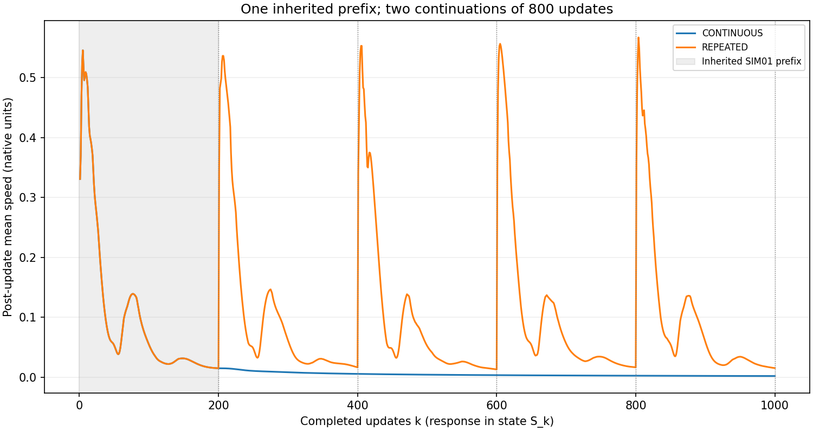
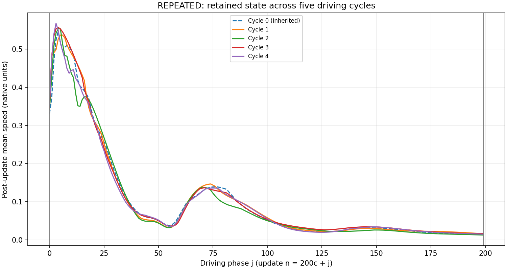
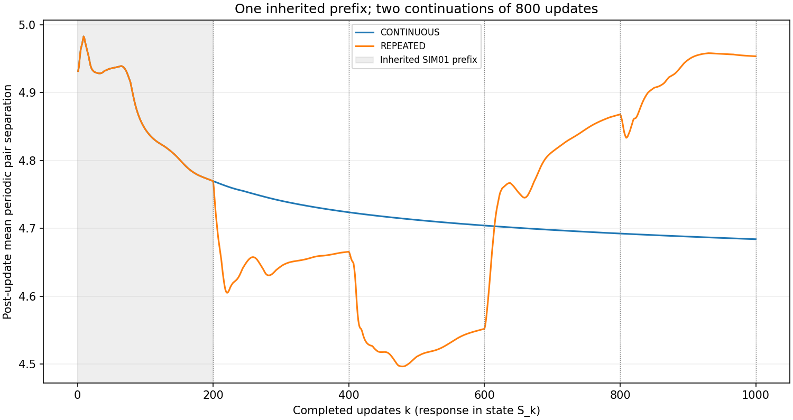
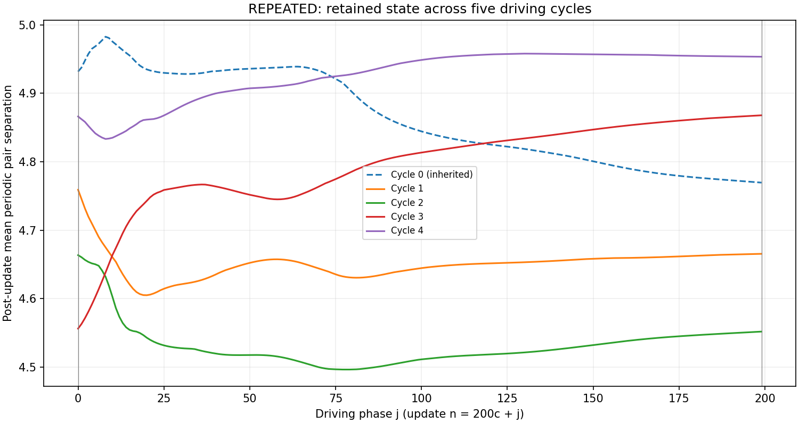
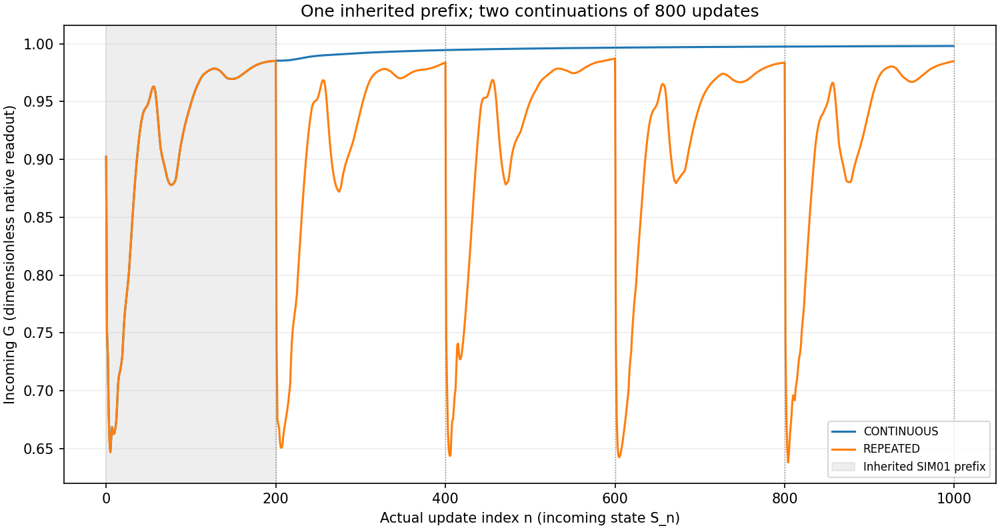
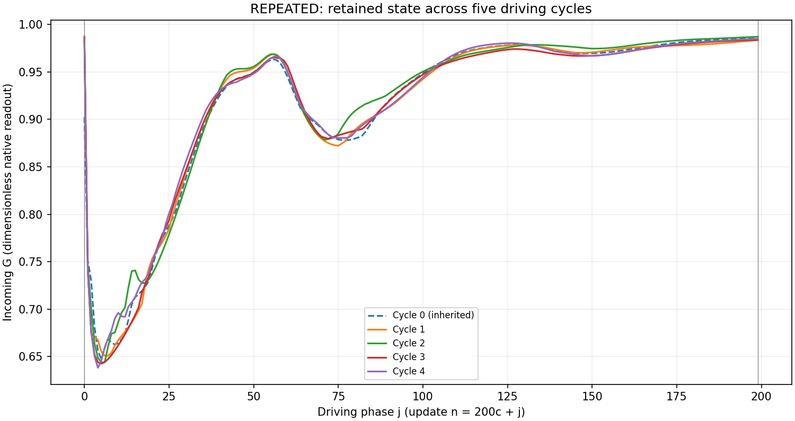

# SRG-SIM02: repeated driving renews motion while the carried state continues to change

14 October 2026 · One bounded paired continuation · For GPT scientific review

Repeating engine C's supplied frames 0–199 renewed its speed response on every observed cycle. Allowing the frame to increase continuously produced progressively smaller speeds over the same number of updates. The REPEATED arm's four new cycle-average speeds were 0.103947, 0.098579, 0.105029 and 0.100533; the corresponding CONTINUOUS averages were 0.008812, 0.004189, 0.002796 and 0.002106. At the final state, mean speeds were 0.015129 and 0.001869 respectively. These are observations over this prescribed finite horizon, in native numerical units.

The repeated drive did **not** reproduce the same labeled configuration at the same phase. Position, velocity and bit comparisons across the prescribed cycles found no exact or operational near-repeat. A further useful result is that the two arms consumed identical random values at identical update/center assignments and retained identical bit histories throughout. Their geometry and velocities nevertheless differed from the first new successor, S_201. Thus random-stream misalignment does not explain the difference between these two arms in this realization.

Renewing a much larger driving amplitude is sufficient to explain why stronger motion is compatible with this intervention. This experiment does not establish learning, a memory advantage, or an asymptotic cycle. Its intervention is the supplied-frame schedule; it observes the complete native response with geometry, velocities, feedback and retained bits coupled together.

The shaded first 200 updates in each actual-count figure are the same inherited SIM01 evidence. They are not two new observations. Vertical dotted lines mark the 200-update boundaries; only REPEATED restarts its supplied frame there.

The accepted SIM01 C prefix supplies updates n=0,…,199 and states S_0,…,S_200. Update n maps S_n to S_(n+1). Each isolated arm restored S_200 and its complete legacy MT19937 checkpoint, then executed n=200,…,999 exactly once: 800 new updates and 801 saved continuation states per arm. The joined analysis view has 1,001 states and 1,000 updates, without duplicating S_200. No update n=1000 was executed. The first block is inherited; the later four blocks are the newly executed experiment.

| Schedule | Frame at actual update n | Time used inside C | State/RNG at boundaries |
|---|---|---|---|
| CONTINUOUS | n | 0.1n | Carried forward |
| REPEATED | n mod 200 | 0.1(n mod 200) | Carried forward |

The byte-preserved [detached C](inputs/detached/engine_C.py), lines 14–33 and 52–73, defines the operator. In readable notation its source functions are

\[
H(t)=2e^{-0.5t}\cos t+e^{-0.3t}\sin t+1.5e^{-0.7t}+e^{-0.4t},\qquad
G(S_n)=\frac{1}{1+\frac18\sum_i\|v_i\|}.
\]

G is computed once from incoming velocities and held fixed for all eight centers. In order i=0,…,7, C recomputes the arithmetic mean of the currently stored wrapped positions, takes the minimal-image displacement from center i to that mean, and divides by its norm plus 0.01. On the open gate G>0.5 it consumes one scalar `np.random.rand()` and toggles bit i if that value is below 0.01. The updated bit supplies the force sign. C then applies the force increment with DT=0.1, applies componentwise `v / (1 + np.log1p(abs(v)))`, advances the position using the resulting velocity and wraps into [0,10). Earlier centers are already updated when the next centroid is evaluated. The wrapper preserved the source expressions and their floating-point grouping; it did not implement a replacement equation.

At the branch, both incoming G values were exactly 0.9853316764949968. The first new H was 0.002636728742286805 for CONTINUOUS and 4.5 for REPEATED. The repeated arm restored the entire driving waveform, including its negative interval: H ranged from −0.11205756265835146 to 4.5. Its five phase-indexed H arrays are exactly equal. The continuous new H range was −0.0008044059807576845 to 0.002636728742286805. Repeated H therefore does not imply repeated realized forces: the centroid directions, velocities, G and bits continue evolving.

Mean speed is the mean of the eight velocity norms. Mean periodic pair separation is the mean over the 28 unordered pairs of `norm(((p_i - p_j + 5) % 10) - 5)`. Speed and separation below belong to post-update states S_(200c+j+1); incoming G belongs to update 200c+j and state S_(200c+j). Keeping that one-state offset explicit avoids mistaking a feedback response for a simultaneous incoming measurement.

| REPEATED cycle c | Evidence | Mean speed | Minimum | Maximum | First response | Last response |
|---:|---|---:|---:|---:|---:|---:|
| 0 | Inherited | 0.102470130 | 0.014886686 | 0.545644710 | 0.330795765 | 0.014886686 |
| 1 | New | 0.103946551 | 0.016337434 | 0.536403763 | 0.348589268 | 0.016337434 |
| 2 | New | 0.098578750 | 0.012879417 | 0.553068391 | 0.340679284 | 0.012879417 |
| 3 | New | 0.105028978 | 0.016437951 | 0.556541707 | 0.343664861 | 0.016437951 |
| 4 | New | 0.100533001 | 0.015128604 | 0.567208084 | 0.353347114 | 0.015128604 |

The similar speed envelopes do not imply a repeated spatial configuration. In particular, periodic pair separation first decreased across the early cycles and then increased; its behavior was not monotone across all five cycles.

| Cycle c | Mean pair separation | Minimum | Maximum | First response | Last response |
|---:|---:|---:|---:|---:|---:|
| 0 | 4.863220330 | 4.769510581 | 4.982581878 | 4.931629341 | 4.769510581 |
| 1 | 4.650320322 | 4.605053076 | 4.759097221 | 4.759097221 | 4.665505799 |
| 2 | 4.531935111 | 4.496473117 | 4.663562704 | 4.663562704 | 4.551917574 |
| 3 | 4.795444474 | 4.556284104 | 4.867813130 | 4.556284104 | 4.867813130 |
| 4 | 4.926751440 | 4.833250154 | 4.957910565 | 4.866089866 | 4.953356429 |

Incoming G remained above 0.5 everywhere. CONTINUOUS had new-update G between 0.9853316764949968 and 0.9981328229465455. The renewed speed in REPEATED brought G down much further within each cycle, but never closed its draw gate.

| REPEATED cycle c | Mean incoming G | Minimum | Maximum | First update | Last update |
|---:|---:|---:|---:|---:|---:|
| 0 | 0.917108955 | 0.646979214 | 0.985281000 | 0.902335656 | 0.985281000 |
| 1 | 0.916755226 | 0.650870574 | 0.985331676 | 0.985331676 | 0.983608358 |
| 2 | 0.920645851 | 0.643886648 | 0.987132860 | 0.983925187 | 0.987132860 |
| 3 | 0.915984449 | 0.642449859 | 0.987284354 | 0.987284354 | 0.983694546 |
| 4 | 0.918719987 | 0.638077362 | 0.984986987 | 0.983827885 | 0.984986987 |

The cross-arm table compares equal actual state indices. Position residuals are norms of labeled-center minimal-image differences; velocity residuals are ordinary labeled-center velocity differences. Their means and maxima are reported separately from bit Hamming counts. These are neither a composite complexity score nor a shape distance invariant under relabeling or rotation.

| State | Position mean | Position max | Velocity mean | Velocity max | Bit Hamming count |
|---:|---:|---:|---:|---:|---:|
| S_200 | 0 | 0 | 0 | 0 | 0 |
| S_400 | 1.276736519 | 2.096531524 | 0.016633132 | 0.024082170 | 0 |
| S_600 | 1.825098338 | 3.374302326 | 0.014924065 | 0.020713868 | 0 |
| S_800 | 2.534525752 | 5.108250936 | 0.016701121 | 0.022497178 | 0 |
| S_1000 | 2.851057951 | 6.573548252 | 0.015896841 | 0.019734041 | 0 |

Positions and velocities first differed at S_201. Bits never differed between the arms. At S_1000 the pair-separation means were 4.683898068 for CONTINUOUS and 4.953356429 for REPEATED. The source energy diagnostic, `0.5 * sum(norm(v_i)**2)`, was 0.00001398340341530699 and 0.0009285466904921905 respectively. This is the source's kinetic-like readout; no physical energy calibration or conservation claim is introduced.

Each new arm consumed eight draws per update, 6,400 total, producing 75 individual bit toggles. The inherited block contains 1,600 draws and 14 toggles. REPEATED's cycle toggle counts were 14 (inherited), 18, 21, 21 and 15. Corresponding CONTINUOUS blocks had identical toggle counts and histories. The final bits in both arms were `[0,1,0,1,0,1,0,0]`.

All 6,400 pairs of values at equal branch draw offsets matched exactly. Their assignments to updates and centers also matched exactly: there was no first loss of alignment. Complete RNG checkpoints matched across arms at S_200, S_400, S_600, S_800 and S_1000. Branch offsets 0–6399 count actual scalar draws; the optional dynamics offsets are 1600–7999. The MT19937 internal position is preserved as part of its checkpoint and is not used as a draw counter.

Across cycles within REPEATED, the RNG continues advancing rather than restarting. Different same-phase responses therefore involve continuing geometry, velocity, G, bits and randomness. Equal randomness **between arms at equal actual updates** does not mean equal randomness **between different repeated cycles at equal phase**.

The following REPEATED boundary table gives the incoming state for each cycle and the final state. Residual pairs are mean / maximum against the preceding 200-update boundary. The bit strings list centers 0–7 in order.

| State | Mean speed | Pair separation | Bits | Position residual mean / max | Velocity residual mean / max | Bit Hamming |
|---:|---:|---:|---|---:|---:|---:|
| S_0 | 0.108235049 | 4.931293065 | 00000000 | — | — | — |
| S_200 | 0.014886686 | 4.769510581 | 01001101 | 1.377164 / 2.300237 | 0.112300 / 0.140995 | 4 |
| S_400 | 0.016337434 | 4.665505799 | 00011101 | 1.364481 / 2.226587 | 0.019374 / 0.033662 | 2 |
| S_600 | 0.012879417 | 4.551917574 | 01011110 | 1.236489 / 1.892300 | 0.016491 / 0.031247 | 3 |
| S_800 | 0.016437951 | 4.867813130 | 01001110 | 1.406475 / 2.332721 | 0.013451 / 0.027354 | 1 |
| S_1000 | 0.015128604 | 4.953356429 | 01010100 | 1.268554 / 1.987064 | 0.023183 / 0.036826 | 3 |

The full same-phase comparisons cover (1,0), (2,1), (3,2), (4,3) and each later cycle against inherited cycle 0. The (1,0) comparison appears in both requested groups; it is not an additional observation. Across all these comparisons there were zero exact position phases, zero exact velocity phases, zero exact bit-vector phases and zero near-repeat phases. For successive cycles, the minimum over phase of the mean position residual was respectively 0.960691, 0.724057, 1.122043 and 1.103934. Their largest centerwise position residuals were 2.237309, 2.160988, 2.332721 and 2.334052. Thus similarity of scalar speed envelopes coexisted with substantial labeled-state differences.

The declared near-repeat rule requires both mean and maximum position residual and both mean and maximum velocity residual to be at most 1e-12, with bits exactly equal. It is an operational diagnostic in native units, not a calibrated physical threshold. Even a passing geometric/bit comparison would not establish recurrence of the full state, which includes RNG state, or a limiting cycle. Every authorized update was completed regardless of these comparisons. Full residual series and extrema are retained in [same-phase differences](analysis/same_phase_labeled_differences.csv) and [their summary](analysis/same_phase_summary.csv).

The legacy displacement detector gave a strikingly different answer from the minimal-image readout. It flags `norm(mod(p_new-p_old,10)) > 1`, which maps a small negative coordinate increment close to +10. It produced 6,400 flags in CONTINUOUS and 5,511 in REPEATED over the new updates. The minimal-image displacement norm exceeded 1 in **zero** new center updates in either arm. Genuine wrapping of stored coordinates occurred in 0 and 27 center updates respectively. These three counts measure different things; legacy flags were preserved, not silently corrected or interpreted as physical teleportation.

| Passive displacement check, new updates only | CONTINUOUS | REPEATED |
|---|---:|---:|
| Largest minimal-image step norm | 0.002018638821313 | 0.060808745441729 |
| Largest absolute component of DT v_i^+ | 0.001292859236213 | 0.047266296285482 |
| Largest absolute residual against minimal-image increment | 8.881513146458131e-16 | 1.3409412469300719e-15 |

All new component increments were strictly below half the box (5), and all residuals were below the specified absolute tolerance 1e-12. This supports a minimal-image lift of these sampled increments consistent with the implemented position increment. No new unwrapped trajectory is presented, and unwrapped positions never fed the evolution. The exact inherited NPZ still contains its historical unwrapped diagnostic.

Compatibility and execution checks passed. All ten consumed files matched their recorded identities; the nine selected artifacts also matched entries of the preserved publication manifest. The accepted arrays loaded without pickle with the expected shapes and dtypes. The saved binary int8 bits were losslessly widened to original C's `dtype=int`, which is int64 here. Positions, velocities and bits were independently owned writable arrays. The complete 624-key MT19937 checkpoint, including position 176, Gaussian flag 0 and cached value 0.0, round-tripped exactly without a test draw.

Four separately isolated preflight processes restored the pristine branch independently. For frame 200 and frame 0, an unobserved call and an accepted observed call produced bitwise-equal positions and velocities, identical bit values and dtypes, identical time/H/G and identical full post-call RNG checkpoints. Observed snapshots confirmed center order 0–7 and the sequential carried states. Gate/draw/toggle checks passed; repeating passive diagnostics preserved carried state and RNG. No preflight successor was used as a rollout input. No fifth preflight call, retry, initialization or new seed occurred.

| Activity | Calls started | Calls completed | Supervisor elapsed | Wall ceiling |
|---|---:|---:|---:|---:|
| Four preflight workers, combined | 4 | 4 | 2.343 s | 60 s total |
| CONTINUOUS | 800 | 800 | 27.187 s | 120 s |
| REPEATED | 800 | 800 | 36.813 s | 120 s |
| Passive analysis | 0 | 0 | 1.781 s | 120 s |
| Total new numerical calls | **1,604** | **1,604** | — | **1,604** |
| Inherited updates rerun | **0** | **0** | — | **0** |

Workers ran serially under a terminating supervisor with exclusive start markers, explicit call counters and aggregate-size checks. Output writes checked the 268,435,456-byte cap, including the eventual review ZIP. Exact runtimes and counters are in [the budget ledger](evidence/BUDGET_LEDGER.json); final preservation and package identities are supplied in [the receipt](SIM02_EXECUTION_RECEIPT.md). Python 3.11.15, NumPy 2.4.4 and Matplotlib 3.10.9 ran under Windows CMD in the existing `torment` environment with `python -B`, a noninteractive backend and temporary/cache paths inside SIM02.

The evidence is organized for review:

- [Frozen experiment specification](EXPERIMENT_SPEC.json), [checkpoint gate](evidence/CHECKPOINT_GATE.json) and [four-call preflight gate](evidence/PREFLIGHT_GATE.json) document what was fixed and checked before rollout.
- [CONTINUOUS states](runs/CONTINUOUS/states.npz) and [REPEATED states](runs/REPEATED/states.npz) contain every new state, explicit indices, incoming H/G, masks, draws, branch offsets, switches and source diagnostics. Each run directory also contains the per-update returned-state journal, draw stream, branch identity, boundary RNG checkpoints and completion record.
- [Scalar readouts](analysis/scalar_readouts.csv), [complete repeated phase curves](analysis/repeated_phase_curves.csv), [cycle summaries](analysis/repeated_cycle_summary.csv), [cross-arm differences](analysis/cross_arm_all_states.csv) and [machine-readable results](analysis/RESULTS.json) preserve the numerical comparisons behind this report. [Comparison arrays](analysis/comparison_arrays.npz) retain the complete plotted curves and phase residuals.
- The exact accepted prefix occurs once under [inputs](inputs/runs/C/states.npz). Its [report](inputs/SIM01_REPORT.md), [GPT review](inputs/review/SIM01_GPT_SCIENTIFIC_REVIEW.md), [original C](inputs/sources/source_C.py), [API](inputs/engine_api.py), [saved-format writer](inputs/worker_replay.py), [access map](inputs/ACCESS_AND_EVIDENCE_MAP.md) and [publication manifest](inputs/PUBLICATION_MANIFEST.json) are preserved as source evidence. The historical GUI program and SIM01 runner were read, never executed. Reviewers should inspect saved evidence; worker entry points are not invitations to rerun this exhausted budget.

The supported conclusion is a schedule-dependent finite response: renewing C's drive repeatedly renews substantial motion while the retained state changes, and substantially different trajectories can occur under equal cross-arm draw and bit histories. This one paired realization supplies no statistical superiority claim, equilibrium result, long-time attractor classification, isolated causal effect of memory, or physical calibration. It leaves those interpretations unresolved by design. The authorized experiment is complete and stops here for GPT scientific review.
