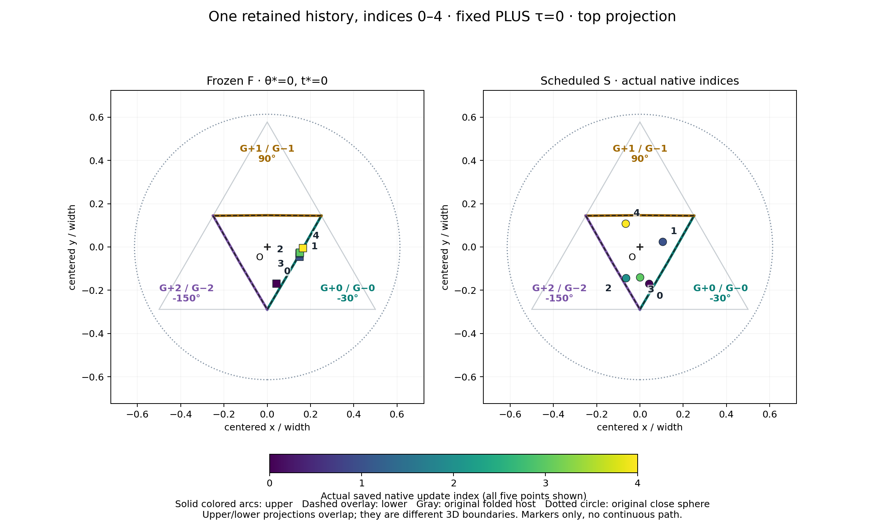
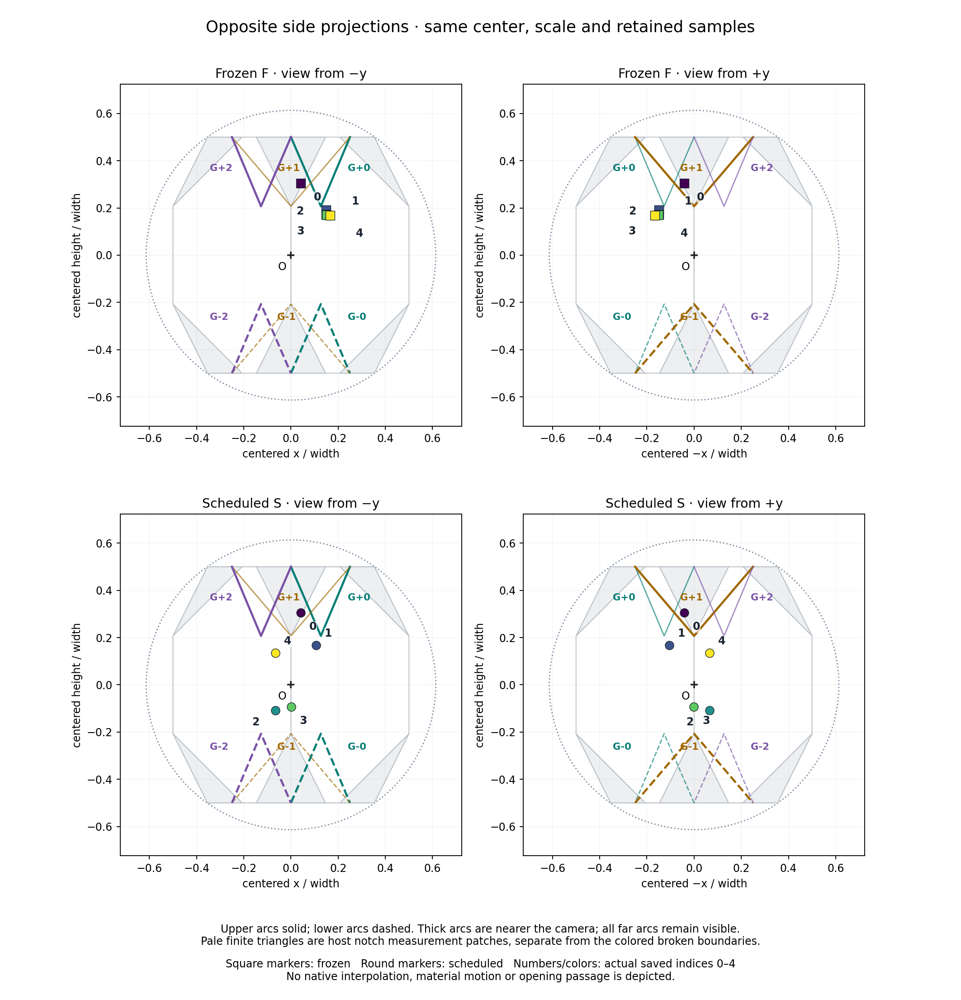
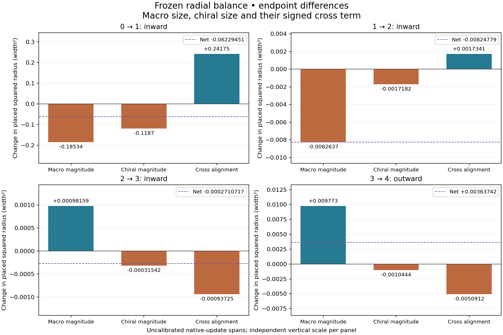

# Understanding Z Motion in the Tri-Octagon Model

## Native changes, observer effects, and fixed-geometry source accounting

Explanatory methods note and application-reading companion

Hilmir Frímann Halldórsson / pzychozen

Scientific direction and internal review: GPT. Documentary consolidation, source reconciliation and typesetting: Codex.

Draft v0.1 | 1 November 2026 | Ready for GPT/author documentation review

### 1. What already moves

The model already has evolving complex states. Their real and imaginary parts can be shown as arrows on three fixed face planes. Z is a different object: an existing readout of the state, with an explicit rule for placing a point in the surrounding geometry. That readout can change because the native state changes, because its observer settings change, or because both change. The shell, openings and reference sphere in these studies remain stationary. [C01]

Freezing the observer does not freeze the native state. In the five-state example, frozen Z changes at every saved step even though the same opening boundary remains nearest. Its radius first decreases and finally increases. The existing native intensity and chirality budgets account for that remaining displacement, including large signed contributions that partially cancel. [C02]

The author's fixed-support and dual-arrangement intuition motivated this clarification. Earlier moving-cone and average-arrow comparisons were separate interpretations; they did not generate the Z histories documented here. The fixed-support picture has not been implemented by this accounting. Golden-ratio language in the cone explanation was illustrative, not a controller requirement. No physical meaning is imposed on the surrounding measuring structure. [C03]

### How to read this note

Sections 2-7 separate the histories, state, observer and geometry. Sections 8-9 explain what the observation can identify. Sections 10-13 connect the existing source budgets to frozen displacement. Sections 14-16 explain all four spans. Sections 17-18 state the evidence limits and source route. The two-page plain-language guide is a separate entry point.

This consolidation introduces no scientific evaluation. Every displayed result is extracted from a verified earlier ledger; equations are restated and explained, not numerically rerun.

<!-- page -->

## 2. Two histories, with one reused for source accounting

| Evidence | Saved indices | Native coefficients | Numerical status |
| --- | --- | --- | --- |
| Z01 | 0, 1 | ε=.05; g=.2; λ_phase=.001; k=(1,1,1) | Binary64 state values; hexadecimal identities preserved |
| Z02 and Z03 | 0, 1, 2, 3, 4 | ε=1/10; g=1/5; λ_phase=17/100; k=(2,3,4) | Historical 120-digit working arithmetic; up to 100 significant digits saved |

Z02 is not a continuation of Z01: both the initialization and native coefficients differ. Z03 reuses Z02's same five-state file, not a third history or an independent repetition. The five-state initialization was deliberately constructed in an earlier nominal study; it was not a random or representative sample. [C04]

Z02 admitted the complete five-state window before its opening comparisons, using its recorded source route and outcome-independent rules. No suffix was selected after viewing the results. Source identity and historical execution accounts establish provenance, not producer authentication or a fresh proof of exact native evolution. [C05]

### Notation and types

| Symbol | Meaning here |
| --- | --- |
| Ω=x+iy | Native complex triad; x and y are real channel triples |
| I, κ | Native squared norm I and norm κ=√I |
| C | Raw channel chirality x×y, used in Z |
| S, A | Symmetric pair matrix and antisymmetric area matrix |
| K, E, Hθ, M | Norm gain, envelope, harmonic direction and macro vector |
| Z; X; r | Blended readout; placed point; centered point X−O |
| Fₙ, Sₙ | Frozen and scheduled placed points, as labeled in source figures |
| P | Native prestage matrix; called M in the source-budget papers |
| L; Lp | Native graph matrix; fixed placement map μRψ |
| G±k; N±k | Central boundary arcs; separate finite host-notch patches |

We write the native map as ℱ, never Fₙ. Hθ is only the harmonic vector; S is the pair matrix, while Sₙ is a scheduled point with an index. P avoids confusing the native prestage matrix with the macro vector M. Numerical lengths use host-width units; state intensity and update index are not calibrated energy, length or time. [C06]

<!-- page -->

## 3. From a native state to a placed observation

For Ω=x+iy, the existing staged construction is [C07]:

$$
I=\|\Omega\|^2,\qquad \kappa=\sqrt{I},\qquad C=x\times y.
$$

$$
K(\kappa)=\lambda_{\rm vp}\frac{\kappa}{1+\kappa},\qquad E(t)=e^{-\gamma t}.
$$

$$
H_\theta=\cos[3(\theta-\ell)](\cos\theta,\sin\theta,1).
$$

$$
M=K E H_\theta,\quad Z=\alpha M+\beta C,\quad X=O+\mu R_\psi Z.
$$

The shared staged preset is N=12, q₀=0, q_step=1, t₀=0 and dt=0.1, with λ_vp=0.618, γ=0.577, lock ℓ=0.244 radians, α=1, β=0.5, μ=1 and ψ=0. These are observer settings, not the native coefficients in Section 2. Literal binary64 constants retain their source meanings; 0.618 is not replaced with an exact golden-ratio expression. [C08]

$$
q_n=(q_0+nq_{\rm step})\ \mathrm{mod}\ N,\quad \theta_n=2\pi q_n/N,\quad t_n=t_0+n\,dt.
$$

A face arrow is instead xᵢtᵢ+yᵢe_z on a fixed plane, with t₀=(−1/2,−√3/2,0), t₁=(1,0,0), t₂=(−1/2,√3/2,0). Its display scale is not the placement scale μ. Three arrows are not three point positions. The established ambient axial attachment W=TC is also distinct: raw C, not W, is the historical input to Z. Neither readout feeds back into ℱ. [C09]

The reference is the accepted PLUS τ=0, width-one geometry, centered at O=(0,√3/6,0). Its original enclosing sphere has radius

$$
\rho_{\rm sphere}=\sqrt{13/12-\sqrt{2}/2}\ \simeq\ 0.613373094.
$$

This is neither an extended-line sphere nor the unit sphere of directions. It is a geometric reference, not a physical wall. The six central openings are finite two-segment boundary arcs; finite host-notch triangles are separate measurement regions. No filled aperture or flux surface is supplied. [C10]

<!-- page -->

## 4. Same state, two observers

Fₙ evaluates Ωₙ at the first-sample settings θ*=t*=0. Sₙ evaluates that same saved Ωₙ at its scheduled θₙ,tₙ. Fₙ and Sₙ are alternatives at one index, not successive native states. A camera change only changes the projection; changing θ or E changes the calculated point in the same fixed spatial frame. [C11]

For adjacent saved indices i,j, use Kᵢ=K(κᵢ), Eᵢ=E(tᵢ), Hᵢ=H(θᵢ), and Lp=μRψ. The ordered native → envelope → clock telescope is [C12]:

$$
D_{\rm nat}=L_p[\alpha E_i(K_j-K_i)H_i+\beta(C_j-C_i)],
$$

$$
D_{\rm env}=L_p[\alpha K_j(E_j-E_i)H_i],
$$

$$
D_{\rm clock}=L_p[\alpha K_jE_j(H_j-H_i)],\quad S_j-S_i=D_{\rm nat}+D_{\rm env}+D_{\rm clock}.
$$

Insert X(Ωⱼ,θᵢ,tᵢ), then X(Ωⱼ,θᵢ,tⱼ), between Sᵢ and Sⱼ. Their differences cancel to the endpoint difference. These hypothetical replacements are accounting evaluations, not intermediate native times or traced crossings. A different replacement order redistributes mixed changes. Chirality lies inside D_nat; it is not an independent fourth top-level contribution.

The global frozen displacement is different:

$$
F_j-F_i=L_p[\alpha E_*(K_j-K_i)H_*+\beta(C_j-C_i)].
$$

D_nat uses the previous scheduled settings; Fⱼ−Fᵢ uses the first-sample settings for every interval. They coincide at 0→1 here and generally differ later. Z03 accounts for the latter throughout. [C13]

For the same index, chirality cancels from Sₙ−Fₙ. That difference still depends on the native norm through Kₙ; the scheduled point is not independent of native state. These identities are vector accounting, not a unique causal partition. Contribution norms and position-angle changes cannot be added as percentages or a physical rotation budget. [C14]

<!-- page -->

## 5. What the retained comparisons actually show

### The two-state Z01 example

<!-- include: tables/z01_points.md -->

Both observers begin at G+0. At state 1, frozen F₁ remains nearest G+0 and scheduled S₁ is nearest G+1. The frozen point moves inward, but farther from its nearest boundary. The Z01 review separately clarified that its label changes at clock replacement in the stated order. This remains one saved native span, with no angle between successive displacement chords available. [C15]

### The five-state Z02 example, reused by Z03

<!-- include: tables/z02_points.md -->

Frozen labels stay G+0; scheduled labels are G+0, G+0, G−2, G−0, G+1. All three scheduled changes occur at clock replacement in the specified telescope. No primary nearest-label tie or precision classification disagreement was reported. This is not a theorem that every possible switch is observer-made. [C16]

<!-- include: tables/chords.md -->

These unsigned angles compare successive discrete displacement chords at middle indices 1,2,3. They are not the centered-position angles quoted for Z01, nor smooth curvature, spin rates or acceleration. An unchanged nearest label does not imply a stationary point. [C17]

<!-- page -->

## 6. Reading the top view

Figure 1 reproduces Z02's original verified sheet without cropping or scientific relayout. The same five states are evaluated under the two observers. Squares mark frozen points, circles scheduled points; color and index labels retain all five samples. No spatial connectors or interpolated path are added. [C18]

Solid upper and dashed lower arcs overlap in this projection because τ=0 pairs them by height reflection. They remain different three-dimensional boundaries. Gray lines show the fixed folded host; the dotted circle is the original enclosing sphere. A projected coincidence is not a three-dimensional contact.

“Nearest” compares distances between competing boundary sets. It does not mean the point is approaching that boundary, that an opening is activated, or that a physical influence points there. For example, in Z02's frozen 1→2 span the center radius decreases from about 0.247125 to 0.229832 while the distance to G+0 increases from about 0.0369743 to 0.0606040. [C19]

The geometry is unchanged between the panels. The apparent change is an observation comparison in one coordinate frame, not a rotation of a support, shell or gap.

<!-- page -->

## 7. Both sides and two different incidence questions

Figure 2 preserves both camera directions, both observer conventions, upper/lower boundaries and near/far arcs. Pale triangles are finite host-notch patches, separate from the colored central arcs. Frozen-marker overlap is retained, not omitted data. [C20]

All primary Z01/Z02 points lie inside the original sphere and off the central boundaries and notch patches. Z01 has no finite-notch forward-ray hit; Z02 has one, from O through F₁ to N+0, although F₁ itself is not on N+0. A ray-incidence test is a direction test, not observed passage or emission. Absence of boundary contact likewise says nothing about passage through an undefined filled aperture. [C21]

<!-- page -->

## 8. What staged Z cannot identify

### Common phase is discarded

Under Ω′=e^(iχ)Ω, the channel vectors transform as x′=cosχ x−sinχ y and y′=sinχ x+cosχ y. The real two-dimensional rotation preserves κ and x×y. Fixed staged Z, its placement and every deterministic measurement of that point against fixed geometry are therefore unchanged. The decoded face arrows need not be unchanged. [C22]

This is an observation-identifiability limitation, not a global symmetry theorem for ℱ, especially on its zero stratum. Z01's retained common-phase markers are display comparisons, not new trajectory samples. The phase-invariance claim is scoped to fixed staged settings and deterministic static-geometry measurements.

### An envelope change can change direction

At fixed state and θ, write Z(E)=aEH+bC with a=αK and b=β. Expansion gives the reviewed identity [C23]:

$$
Z(E_1)\times Z(E_2)=ab(E_1-E_2)(H\times C).
$$

When the prefactor and H×C are nonzero, the two vectors are nonzero and nonparallel. A fixed nonzero isotropic scale and rotation preserve that distinction. Varying the macro weight can therefore turn the full blended readout without turning H itself. Parallel or zero degeneracies do not support that conclusion. Z01's retained envelope-only example changes centered direction by about 0.222623 degrees; no envelope experiment is rerun here.

### EMA is a separate observer

The existing EMA variant has a cubic innovation J=Im(Ω₁ conjugate(Ω₂) Ω₃), normalized by 1+|J|, and stored memory. Its update uses the literal innovation weight 0.01. Under common phase the cubic product gains e^(iχ), so J can change even when κ and C do not. Current memory and history can matter. [C24]

No EMA evaluation or memory advance belongs to these studies or this consolidation. “All Z variants discard phase” would be an incorrect generalization. C, W and Γ are not asserted to determine the complete native state or its future.

<!-- page -->

## 9. Geometry deductions and their hypotheses

### A sufficient nearest-label bound

For a nonempty fixed boundary set Gₐ, distance dₐ(p) is 1-Lipschitz by the triangle inequality. If a is uniquely nearest at p with runner-up margin m, then every competitor at q obeys [C25]:

$$
d_b(q)-d_a(q)\geq m-2\|q-p\|.
$$

Thus m>2||Sₙ−Fₙ|| is sufficient for nearest-label stability. Failure is inconclusive. Z02's numerical diagnostic succeeds at n=0,1. It fails at n=2,3,4, where separate retained distance results happen to show disagreements. Failure is not a switch predictor. The 10⁻¹² width tolerances and 4×10⁻¹² screening allowance are not proved interval enclosures.

### Height distinguishes the paired levels, not the gap index

This is a separately labeled Z02 reviewer deduction. At τ=0, reflect each upper boundary point (u,v,t), with t≥h>0, into the lower point (u,v,−t). For p=(x,y,w), the squared-distance difference is 4wt. Therefore [C26]:

$$
d(p,G_{-k})^2\geq d(p,G_{+k})^2+4hw\quad (w>0).
$$

Every lower candidate then has a closer upper partner; for w<0 the roles reverse. At w=0 corresponding upper/lower distances tie. This does not select among same-level gaps and is not extended to the twisted/dilated lower geometry at nonzero τ.

### The sampled harmonic sign is observer structure

At θₙ=nπ/6, the macro height factor is cos(nπ/2−3ℓ). For n=0,1,2,3,4 it reads cos(3ℓ), sin(3ℓ), −cos(3ℓ), −sin(3ℓ), cos(3ℓ), giving signs +,+,−,−,+ at the declared lock. This is another Z02 reviewer deduction from the preset. [C27]

The full height includes βC_z, so the macro signs alone do not determine every full readout. The stored negative scheduled heights at n=2,3 reflect the actual balance. No native four-update period, periodic full Z or persistent hemisphere preference is discovered.

<!-- page -->

## 10. The existing finite intensity budget

For one before-state define sᵢ=|Ωᵢ|², D=diag(k−s) and graph L with diagonal −2 and off-diagonal 1. Both increments use the same state; they are simultaneous, not sequential stages [C28]:

$$
u=\epsilon D\Omega,\quad v=gL\Omega,\quad \widetilde\Omega=\Omega+u+v=P\Omega,
$$

$$
P={\rm Id}+\epsilon D+gL.
$$

Expansion of the squared norm gives three parent terms:

$$
\Delta I_{\rm model}=B_{\rm on}+B_{\rm graph}+B_{\rm square},
$$

$$
B_{\rm on}=2\epsilon\sum_i(k_i s_i-s_i^2),\qquad B_{\rm graph}=-2g\sum_{i<j}|\Omega_i-\Omega_j|^2,
$$

$$
B_{\rm square}=\|u+v\|^2=\|u\|^2+2\operatorname{Re}(u^\dagger v)+\|v\|^2.
$$

The last three children are an alternative expansion of B_square, not additional parent terms. The square is an exact finite-step contribution, not an error term that can be discarded merely because its source API calls it a remainder. Phase synchronization preserves each prestage modulus, so its ideal intensity increment is zero. [C29]

<!-- include: tables/intensity.md -->

Table values are extracted from Z03's retained 120-digit ledger, rounded for display. The source API's observed_delta compares a reconstructed prestage with its before-state. It is not a saved-next-state check. Z03 additionally retained R_I=ΔI_saved−ΣB_l, keeping model-to-data comparison separate from the algebraic identity. [C30]

<!-- page -->

## 11. Five amplitude terms and two phase-area terms

Use S=xxᵀ+yyᵀ, A=xyᵀ−yxᵀ and C=(A₂₃,A₃₁,A₁₂), with one-based channel indices. Then ΩΩ†=S−iA, while conjugate pair products are S+iA. The signs and the absence of a factor 1/2 in A matter. [C31]

Since P is real, S̃=PSPᵀ and Ã=PAPᵀ. Also C̃=cof(P)C: the cross-product/minor identity is polynomial and remains valid when P is singular. It needs no inverse. Expanding Ã−A retains all five amplitude terms [C32]:

$$
\epsilon(DA+AD)\quad [\mathrm{onsite\_first}],
$$

$$
g(LA+AL)\quad [\mathrm{coupling\_first}],\qquad \epsilon^2DAD\quad [\mathrm{onsite\_squared}],
$$

$$
\epsilon g(DAL+LAD)\quad [\mathrm{mixed}],\qquad g^2LAL\quad [\mathrm{coupling\_squared}].
$$

The simultaneous native kicks use prestage phases φᵢ=Arg0(Ω̃ᵢ) and δᵢ=λ_phase Σ_(j≠i) sin[3(φⱼ−φᵢ)]. Arg0(0)=0; λ_phase=0 retains the source bypass. For nonzero pairs the equivalent sine is the imaginary part of the normalized conjugate pair cubed; the cube is inside Im, with no division at zero. [C33]

Set dᵢⱼ=δⱼ−δᵢ. The two further terms are entrywise, not matrix trigonometric functions:

$$
A^+_{ij}=\widetilde A_{ij}\cos d_{ij}+\widetilde S_{ij}\sin d_{ij},
$$

$$
\widetilde A_{ij}(\cos d_{ij}-1)\quad [\mathrm{phase\_existing\_area}],
$$

$$
\widetilde S_{ij}\sin d_{ij}\quad [\mathrm{phase\_symmetric\_pair}].
$$

Extract each term's cyclic C triple c_t. Z03 stored R_C=ΔC_saved−Σc_t. Both phase terms depend on the same mixed prestage; these are not seven independent causes or interventions. Prestages and kicks were diagnostic reconstructions in Z03, not saved intermediate states. Both S and A are needed; C, W and Γ do not close the full dynamics. [C34]

<!-- page -->

## 12. Carrying the sources into frozen displacement

At the adopted first-sample freeze, E*=1, H*=cos(3ℓ)(1,0,1) and r=KH*+C/2. For saved endpoint norms a,b with a+b>0, subtracting the rational gain and using b²−a²=(b−a)(b+a) gives the reviewed finite divided difference [C35]:

$$
K(b)-K(a)=q_{ij}(I_j-I_i),\qquad q_{ij}=\frac{\lambda_{\rm vp}}{(a+b)(1+a)(1+b)}.
$$

This is exact in real arithmetic, not a derivative approximation. It remains valid when a=b>0. If a=b=0, ΔK=0 and q is undefined; no arbitrary denominator is supplied.

Each parent intensity term B_l contributes d_l^I=H*qB_l. Each of the seven area triples contributes d_t^C=c_t/2. The model-to-data residual contributes

$$
d_{\rm res}=H_*q_{ij}R_I+R_C/2.
$$

The actual saved displacement equals the sum of these vectors, d_res and a separately retained readout arithmetic residual. Squared-increment child vectors can replace their parent vector, but are not added a second time. These are two pathways from the same update to the same readout, not independent forces. [C36]

### The transverse part has no norm-gain contribution

For nonzero H*, let Q=Id−H*H*ᵀ/||H*||². Since QH*=0, identity placement gives [C37]:

$$
Q\Delta r=\frac{1}{2} Q\Delta C,\quad \Delta r_y=\frac{1}{2}\Delta C_y,
$$

$$
\Delta(r_x-r_z)=\frac{1}{2}\Delta(C_x-C_z).
$$

These are centered coordinates: absolute X_y includes O_y=√3/6. The seven signed chiral terms and R_C account for transverse motion even when the nearest label is unchanged. A different frozen anchor changes H*, so freezing is not observer-independence. At zero H* the projector direction is undefined, not assigned a default axis.

<!-- page -->

## 13. Two radial accounts that must stay separate

### Fine source-resolved accounting

For each already retained displacement contribution d_a, define a signed squared-radius term [C38]:

$$
B_a^{\rm rad}=(r_j+r_i)\cdot d_a,\qquad \Delta\|r\|^2=(r_j+r_i)\cdot\Delta r.
$$

The sum includes the model-to-data residual vector and the readout arithmetic residual; Z03 also retains the final arithmetic closure residual. Divide by ||rⱼ||+||rᵢ|| only when nonzero to obtain an additive ordinary-radius ledger. If both radii vanish, that ratio is undefined.

### Coarse endpoint accounting

Independently expanding the squared norm yields [C39]:

$$
\|r\|^2=K^2\|H_*\|^2+\|C\|^2/4+K H_*\cdot C.
$$

The next table takes the difference of each term between saved endpoints. “Macro size,” “chiral size” and “cross term” describe this expansion. The cross term changes with both magnitude and alignment, not angle alone.

<!-- include: tables/radial.md -->

The fine account asks which source-term vectors contribute to the signed radial difference. The coarse account asks how the two readout magnitudes and their cross term change. Do not combine entries from these alternative accounts. Contribution-vector norms and absolute-sum/net cancellation ratios are neither additive percentages nor physical causal shares.

At 2→3, the source-resolved radial absolute-sum/net ratio is about 223.9. The net is small relative to its opposing terms; this is decomposition-dependent cancellation, not an error bound, an equilibrium test or 223.9 independent effects. [C40]

<!-- page -->

## 14. The first two five-state spans

### 0→1: a large inward step with an essential square

From I₀ approximately 9, the onsite contribution −5.203523 and graph contribution −10.257851 reinforce the intensity decrease. The finite square adds +6.756671, leaving ΔI≈−8.704703 and I₁≈0.295297. Dropping it would give a negative final intensity and is not an exact account. Its three children are about +0.996730, +2.682586 and +3.077355. [C41]

The macro x and z changes are each −0.182919. The chiral displacement is approximately (+0.289380,+0.124479,+0.070342). They oppose in x and z, leaving x positive and z negative. The transverse y increase is entirely chiral. Its large positive coupling_first and mixed contributions oppose negative onsite_first and coupling_squared contributions; the two phase terms together slightly reduce that y increase.

The coarse squared-radius balance is −0.185341 macro size, −0.118705 chiral size and +0.241751 cross term. The positive cross-term change offsets much of the two magnitude decreases. Ordinary radius falls about 0.104109. A strong native intensity loss therefore does not transfer directly into one spatial direction or a proportional radius change.

### 1→2: a small x change hides opposing components

Onsite +0.169119 and the square +0.036439 oppose graph −0.272961, giving ΔI≈−0.0674034. Within the square, the mixed child is negative, about −0.0718421, between positive onsite² and graph² children. These are smaller sources than at 0→1, with cancellation still important. [C42]

Macro x decreases about 0.0133118; chiral x increases about 0.0141878. The actual x change is only +0.000876039. In z the two changes reinforce a decrease of about 0.0201214, while y increases about 0.0159642. Small x is not uniformly small displacement.

The macro-size radial term falls about 0.00826369. Chiral-size decrease and cross-term increase almost cancel each other, leaving Δradius≈−0.0172925. Moving inward does not mean approaching G+0: its retained boundary distance increases in this span.

<!-- include: tables/displacements_early.md -->

These vectors and radius changes are extracted results, not a continuous path or a newly evaluated map.

<!-- page -->

## 15. The small middle balance and final outward step

### 2→3: intensity rises while radius falls

Onsite +0.146816 and graph −0.164628 nearly balance. The +0.0253610 finite square makes ΔI positive, about +0.00754918; dropping it would reverse that predicted sign. Macro x and z each rise about 0.00164299. Chiral z falls about 0.00322774, so full height still falls. [C43]

Macro-size squared radius rises +0.000981589, but chiral-size −0.000315415 and cross term −0.000937245 outweigh it. The net Δradius is −0.000590475. The small result reflects opposing retained terms, not native inactivity. The source-resolved cancellation ratio of about 223.9 belongs to the fine decomposition, not this three-entry coarse split.

### 3→4: farther from the center, slightly lower

Onsite +0.158908 exceeds graph −0.100758; the square adds +0.0237968, giving ΔI≈+0.0819467. Macro x and z rise about +0.0154716 each. The chiral displacement is approximately (−0.000670044,+0.0211527,−0.0166755), leaving a positive x/y change but a slightly negative height change. [C44]

The coarse squared-radius balance is +0.009772971461−0.001044366176−0.005091184838≈+0.003637420448. Macro growth outweighs the two opposing terms. Ordinary radius rises +0.007800865379. The phase symmetric-pair term contributes about +0.0144813 to y and −0.00478717 to the fine radial balance. A positive coordinate contribution is not an intrinsically outward mechanism.

<!-- include: tables/displacements_late.md -->

### A limited explanation for the later onsite signs

The Z03 reviewer noted that the saved before-state intensities I₁,I₂,I₃ are all below 0.3, while min(kᵢ)=2. Each component intensity is bounded by the total, hence sᵢ<kᵢ. With ε>0, each 2εsᵢ(kᵢ−sᵢ) is nonnegative, and positive for nonzero sᵢ. This explains the positive aggregate onsite terms in the last three spans. It is an elementary inference from retained values and the existing formula, not a new test or a long-term theorem. [C45]

<!-- page -->

## 16. Seeing the coarse radial balance

Figure 3 is the verified Z03 original, unchanged. Each panel shows endpoint differences of macro magnitude, chiral magnitude and their cross term. Its “cross alignment” label includes changes in magnitude as well as relative alignment. The dashed line marks the net squared-radius change. [C46]

The panels have independent vertical scales, as the original sheet states. They must not be compared by bar height alone. Axes distinguish placed squared radius from the native intensity in Section 10; index spans are uncalibrated updates, not seconds.

The first two spans have negative macro-size changes. At 2→3 the macro-size change is positive but outweighed by the other two terms. At 3→4 it is large enough to outweigh them. The reversal follows from the existing vector blend and retained state changes; no force, added clock or fitted motion rule is required to account for these endpoints.

The complete seven-component chiral and fine radial ledgers remain in the package. They answer a more detailed accounting question than this figure and should be read without adding their entries to the coarse bars.

<!-- page -->

## 17. What the evidence establishes

The completed chain connects native-state dependence, observer-controlled comparison and existing source identities applied to frozen displacement. It makes the readout more understandable without identifying it as a material core, gravitational field, energy flux, orbit, support law or demonstrated duality mechanism. The fixed-support and two-arrangement programme context is neither completed nor rejected. Separate cone, SRG reconstruction, gravity and coherence-return work is not reopened. [C47]

### Numerical agreement has a limited scope

Z01's primary inputs are binary64. Z02's application-style overlay converts retained decimal strings to binary64, while its independent 80-digit comparison used the original strings and exact lifts of binary64 observer constants. The historical saved Z used ideal-decimal constants and was compared separately, not claimed bit-identical. Z03 used exact rational native coefficients and 80/120-digit arithmetic on the saved rounded state strings. [C48]

Z03's largest retained 120-digit saved-after residual is approximately 1.27×10⁻¹⁰⁰. Its screen was 10⁻⁶⁵ times an explicit scale; the residuals and 80/120 agreement remain numerical corroboration, not interval bounds or an exact native trajectory certificate. R_I, R_C and readout arithmetic residuals remain distinct.

Because I and C discard common phase, their agreement cannot authenticate every complex component of a next state. Rephasing an after-state would leave those checks unchanged. No hidden phase trajectory is recovered. Previously accepted results retain their own hypotheses and evidence status; none is recertified here. [C49]

| Earlier procedure | Retained outcome | Scope |
| --- | --- | --- |
| Z01 Windows study; reviewed 31 Oct 2026 | 186 assertions | Two-state observation study |
| Z02 Windows study; reviewed 1 Nov 2026 | 246 assertions | Five-state observer/geometry comparison |
| Z03 Windows study; reviewed 1 Nov 2026 | 1,851 logged checks; 80 portable checks | Eight primary budgets: four at 80 digits and four at 120 |

These counts were not run or added together in this documentation pass. Z03's 13 synthetic fixtures included four full synthetic budgets across both precisions, separate from the eight primary budgets. The earlier Linux reviews had their own scopes: Z01/Z02 showed last-bit platform differences without changed classifications; Z03's copy-only result matched. They are not second Windows certifications. [C50]

<!-- page -->

## 18. Sources, review status and adoption

This note is ready for GPT/author documentation review. The recommended home is a project methods guide paired with an application-reading companion. An explanatory appendix is also suitable where a paper needs this interpretation context. A standalone physics publication is not the default: the contribution is a connected account of existing mathematics and bounded examples, not a new physical law. No destination is edited or published by this package. [C51]

### Source references

Z01: “Existing Z against fixed geometry,” NCM-Z-01 v0.1. Use the archived REPORT sections “Typed map,” “Reproduction and numeric meaning,” “The ordered native → envelope → clock telescope,” and “Two exact corollaries.” Its GPT review is dated 31 October 2026.

Z02: “Frozen versus scheduled retained-history Z,” NCM-Z-02 v0.1. Use “Admission before outcomes,” “Complete endpoint results,” “Ordered attribution and the two freezes,” and “Independently verified margin bound.” Its 1 November 2026 GPT review separately supplies the mirror-height and sampled-harmonic deductions.

Z03: “Native-source accounting of frozen Z displacement,” NCM-Z-03 v0.1. Use “Inherited native identities,” “Derived finite readout and radial bookkeeping,” all four span explanations, and “Verification, uncertainty and stopping boundary.” Its 1 November 2026 GPT review supplies the later-onsite-sign inference and the explicit full-state-certification limitation.

The defining archived sources are motion_observer.py (clock, staging, placement), z_manifold.py (staged/EMA distinction), readouts.py (raw C), dynamics.py (native prestage and phase convention), z_diagnostics.py::intensity_budget, axial_observables.py::axial_source_budget, and Paper G v0.1.1 Section 3 (cofactor and phase-pair identities). Source snapshots retain their exact bytes; current checkout identity is not assumed.

### Finding a claim or value

Claim tags [C01]-[C51] resolve in CLAIM_SOURCE_MAP.md to report passages, archived functions/equations, ledger rows and evidence classes. Generated tables have exact JSON pointers, original numeric strings and rounding policies in manuscript/tables/TABLE_PROVENANCE.json. EVIDENCE_INDEX.md links portable extracted copies and explicitly names ZIP members when material remains archived. No path into a ZIP is presented as an ordinary file.

The original archives remain intact, including their inactive historical scripts. Current QA verifies bytes, transcription, table totals, links and final PDF rendering. It does not execute those scripts, calculate observations or check live originals behind earlier preservation records. Only the current supplied ZIP and standalone order are rehashed as this pass's bounded original-input preservation check.

The editable narrative is NOTE.md with its declared table includes. The PDF is generated from those inputs. No automatic successor investigation follows documentation review.
