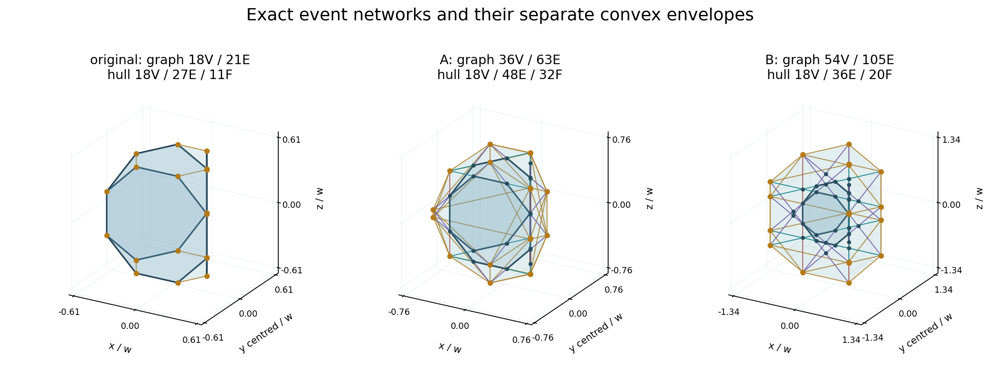
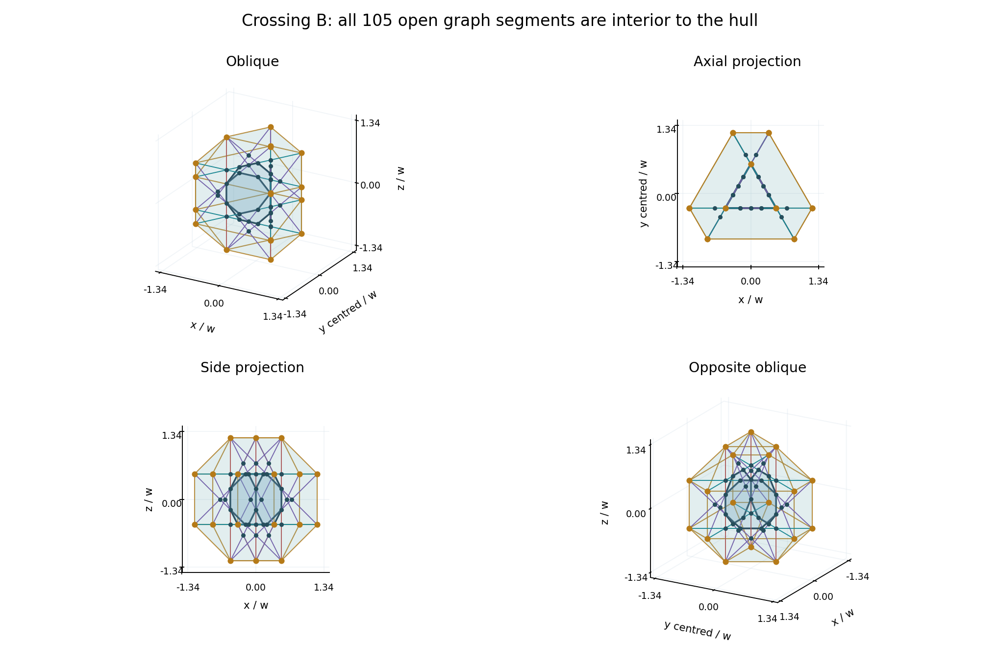

# BOUNDARY-12 — Natural terminations, unit lengths and scale meaning

16 October 2026. Owner and research author: Hilmir Frímann Halldórsson. Mathematical direction/reconciliation: GPT. New execution: Codex. Status: isolated mathematical and observation-prototype submission for review.

## Findings

**On every one of the 42 outward rays, Crossing A is the first strictly later meeting with another original supporting line, and Crossing B is the last finite meeting.** Every ray participates in both events. At A the complete sphere-to-sphere segment has length **w**; at B the added extension beyond **each original endpoint** has length **w**. These are different exact unit-length facts.

The three split spatial graphs are connected, with `(V,E,cycle rank)` equal to **(18,21,4)**, **(36,63,28)** and **(54,105,52)**. Their separate convex hulls have `(V,E,F)` equal to **(18,27,11)**, **(18,48,32)** and **(18,36,20)**. At the original sphere all 21 graph edges lie on hull edges. At A and B, the relative interior of **every** split graph edge is strictly inside the hull; only the 18 outer graph vertices lie on its boundary. Filling a surface is a separate construction.

The exact analytic coefficient 10 and target T=πeφ have documented scalar meanings. The four prescribed geometric ratios do not numerically match T/10. No source-defined aggregate matching the recollection “the constants approach 10” was recovered in the bounded pass. No constant correspondence was fitted.



Dark lines are original edges; red/teal/violet lines are added seam/horizontal/chamfer segments; gold lines are actual hull edges. Transparent filled hulls are explicitly added mathematical enclosures. Each view uses its own radius scale. Projected crossings alone are not spatial vertices.

## 1. Authority, coordinates and preserved objects

The handoff manifest, six selected original BOUNDARY-11 members and complete subsequent GPT review ZIP were byte-verified. The selected members also match the existing local files and full original archive. The original submission SHA-256 is `4bd26f23df8399abae332106a7c3f57d4698f4cc8a899114e732b5d7f88be431`. The subsequent review SHA-256 is `77fb14d41ca9f5089f423bf926d649022aa307300165fc105de0dc921e0420a9`. Its §4 supplies the three-term octagonal-ratio observation; that observation is not attributed retroactively to the original report.

Paper C v1.0.1 remains the coordinate authority. Its complete local Markdown file matches SHA-256 `5a0cbdae4aaf689cfe1f5b29305960e90c88e26d0db28834802ef70fc16549fb`. The pinned checkpoint `e1f5115402a05965834493c1254b03118a531c92` is a source identifier, not a claim about current main. No Git command was needed.

All formulas use coordinates relative to `o=(0,√3 w/6,0)` and positive panel flat-to-flat width w. The unchanged face cycles are

```
P1: 0,1,2,3,4,5,6,7
P2: 3,8,9,10,11,12,13,4
P3: 10,14,15,0,7,16,17,11
```

Original E01–E21 IDs, V0–V17 IDs and oriented ± branch labels are retained. The exact original coordinates and directions are in `incoming/reference/BOUNDARY11/data/geometry_inventory.json`; all newly constructed coordinates are also written explicitly in the new inventories. No original analytical script, review checker or PDF build was rerun.

Write

\[
s=(\sqrt2-1)w,\quad h=s/2,\quad a=w/\sqrt3,\quad
\rho^2=w^2(13/12-\sqrt2/2),\quad
q_e^\pm=m_e\pm t u_e,\quad R^2=a^2+t^2,\quad t\ge h.
\]

Here `u_e` is the original unit direction, `m_e·u_e=0`, `|m_e|=a`, and the original endpoints are `m_e±h u_e`. The green reference sphere remains edge-tangent, not face-tangent.

## 2. Lengths and raywise terminations: proofs

**Equal-length theorem.** Because `|u_e|=1`, subtracting the two exits gives

\[
C=|q_e^+-q_e^-|=2t,
\qquad \ell=|q_e^\pm-(m_e\pm h u_e)|=t-h,
\qquad 2\ell=C-s.
\]

Thus all 21 complete segments share C and all 42 outward additions share ℓ at each fixed R. This is a consequence of the common tangent sphere, not an additional imposed equality. R measures from the shell centre; t measures from an edge midpoint along the line. These quantities must not be interchanged.

| Event | t/w | C/w | ell/w | 2ell/w | R²/w² |
|---|---|---|---|---|---|
| original | $- \frac{1}{2} + \frac{\sqrt{2}}{2}$ | $-1 + \sqrt{2}$ | $0$ | $0$ | $\frac{13}{12} - \frac{\sqrt{2}}{2}$ |
| A | $\frac{1}{2}$ | $1$ | $1 - \frac{\sqrt{2}}{2}$ | $2 - \sqrt{2}$ | $\frac{7}{12}$ |
| B | $\frac{1}{2} + \frac{\sqrt{2}}{2}$ | $1 + \sqrt{2}$ | $1$ | $2$ | $\frac{\sqrt{2}}{2} + \frac{13}{12}$ |

At A, `ℓ/w=1−√2/2=(√2−1)/√2=s/(√2 w)`. The last quantity is the original square-to-octagon chamfer cutback. Therefore the equality is an identity of already defined lengths, without any motion or force claim. At B, `ℓ=w` and `C=(1+√2)w`, rather than `C=w`.

**First/last theorem.** At any intersection x of two original lines, their common tangent-sphere radius gives `|x|²=a²+t_e²=a²+t_f²`, hence `|t_e|=|t_f|`. Consequently a distinct-line meeting is necessarily represented in the accepted common-parameter branch catalogue; unequal along-line magnitudes cannot hide another meeting. The accepted exhaustive line catalogue has 90 intersecting pairs, 108 skew pairs and 12 distinct parallel pairs. Distinct-line meetings occur only at absolute along-line parameters `t0=h`, `t1=w/2`, `t2=(1+√2)w/2`. This study consumes that catalogue; it does not resolve the old pair system again. The catalogue also has the trivial meeting of a line's own ± parametrizations at t=0, which is excluded because the criterion requires a *different supporting line*.

Every event incidence group has size two or three, and its groups partition all 42 branch labels. Thus each ray has a distinct-line meeting at all three parameters. Starting at its original endpoint excludes t0. Since `h<t1<t2` and the accepted complete catalogue contains no further distinct-line meeting, its first strictly later meeting is t1 and its last is t2. This applies to each labelled ray individually, not merely to the union of dots. `data/terminations_and_lengths.json` records the original endpoint, outward direction, co-incident labels, exact point and dot ID for both meetings of every ray.

These two clipping rules consequently select the common concentric spheres

\[
R_A^2=7w^2/12,\qquad R_B^2=w^2(13/12+\sqrt2/2).
\]

The lines themselves are infinite. “First meeting” and “last finite meeting” are geometric stopping conventions; neither makes a physical object stop or reflect.

The subsequent GPT observation is exactly

\[
\sigma=1+\sqrt2,\qquad (t_0,t_1,t_2)=h(1,\sigma,\sigma^2),\qquad t_0t_2=w^2/4.
\]

It is a three-term relation for this finite arrangement. The additive `a²` in `R²=a²+t²` prevents treating it as a progression of sphere radii, and the complete incidence result prevents extending it into further finite meeting events.

## 3. The finite straight-line graphs

At event index `k=0,1,2`, the points on each original line, in exact order, are

\[
q_e^-(t_k),\ldots,q_e^-(t_0),q_e^+(t_0),\ldots,q_e^+(t_k).
\]

There are `2(k+1)` such points and `2k+1` consecutive subsegments. Distinct supporting lines are not coincident, so positive-length subsegments cannot overlap. Each successive outer event supplies 18 new vertices and splits the 42 outward additions at their actual endpoints. Thus

\[
V_k=18(k+1),\qquad E_k=21(2k+1).
\]

The original welded graph is connected. Each added outward segment attaches to its existing endpoint, so connectivity is retained. Therefore its cycle rank is `E−V+1=4+24k`. An outer double/triple meeting has degree 2/3. Once an event becomes internal to a later clipped segment, each of its two/three distinct lines continues both ways, producing degree 4/6.

| Event | V | E | Components | Cycle rank | Degree: number |
|---|---|---|---|---|---|
| original | 18 | 21 | 1 | 4 | 2: 12, 3: 6 |
| A | 36 | 63 | 1 | 28 | 2: 12, 3: 6, 4: 12, 6: 6 |
| B | 54 | 105 | 1 | 52 | 2: 12, 3: 6, 4: 24, 6: 12 |

These formulas agree with exact spatial deduplication, explicit adjacency and connected-component traversal in the new inventories. Every graph edge records its original E-ID, ray ID if added, interval of signed t, exact length and hull locus. Degree-2 outer corners are retained as vertices. No great-circle edges, nearest-neighbour links or merely projected crossings were inserted.

In each original panel plane, the unsplit endpoint connections are the accepted convex octagon at the original radius, two squares at A, and the octagram `{8/3}` at B. At A the square outlines have actual interior intersections: splitting there makes the full framework connected. These section descriptions do not replace the 3D graph or supply a time-periodic recursion.

## 4. Convex envelopes: complete supporting-plane certificates

Define independently `H_k=conv(P_k)`, where P_k is the set of 18 unique outer points at the selected event. Convexification is the explicit enclosure convention. It fills polygon faces which are not inferred from the line graph.

**Every outer point is a true hull vertex.** For `p∈P_k`, all points have norm R_k, and `p·x≤R_k²`, with equality only when `x=p`. Hence p is exposed by its own tangent plane. The hull's vertex set is exactly P_k; rendering triangulations cannot add actual polyhedral vertices or faces.

| Event | V | E | F | Maximal face types |
|---|---|---|---|---|
| original | 18 | 27 | 11 | 3 × 8-gon regular; 6 × isosceles triangle; 2 × 6-gon nonregular |
| A | 18 | 48 | 32 | 30 × isosceles triangle; 2 × 3-gon regular |
| B | 18 | 36 | 20 | 6 × isosceles triangle; 6 × isosceles trapezoid; 6 × rectangle; 2 × 3-gon regular |

The six nonrectangular quadrilaterals at B are isosceles trapezoids, with three sides w and fourth side `(1+√2/2)w`. Rectangles occur in two separate symmetry orbits of size three. The full exact side-squared and turn-dot sequences of every face are supplied, so equal combinatorial types are not silently treated as congruent faces.

**Finite exact construction and completeness.** For each of the `C(18,3)=816` triples, form the cross-product normal n of its affine plane. Discard collinear triples and merge proportional plane equations. Evaluate all 18 residuals `n·p−d` in `Q(√2,√3)`. A plane is retained precisely when all residuals have the same weak sign; orient it to `n·x≤d` with `d>0`. Its complete zero set is the maximal coplanar face. Every facet of a full-dimensional finite convex hull contains three noncollinear vertices, so this exhaustive enumeration omits no facet.

For a compact independently usable description, the following table lists one outward plane `n·(x/w)≤d` per D3h face orbit. Apply rotations by 120 degrees about z, reflection `x→−x`, and reflection `z→−z`, removing duplicate planes. Coordinates are centred. The orbit sizes sum to the face counts above.

| Event | Orbit size | Face type | n | d |
|---|---|---|---|---|
| original | 3 | 8-gon regular | $(-1, \frac{\sqrt{3}}{3}, 0)$ | $\frac{1}{3}$ |
| original | 6 | isosceles triangle | $(0, 1, - \frac{\sqrt{3}}{2})$ | $\frac{\sqrt{3}}{12} + \frac{\sqrt{6}}{4}$ |
| original | 2 | 6-gon nonregular | $(0, 0, -1)$ | $\frac{1}{2}$ |
| A | 6 | isosceles triangle | $(0, 1, - \frac{\sqrt{6}}{2} + \frac{\sqrt{3}}{2})$ | $\frac{\sqrt{3}}{12} + \frac{\sqrt{6}}{4}$ |
| A | 12 | isosceles triangle | $(1, \frac{\sqrt{6}}{3}, - \frac{1}{2})$ | $\frac{1}{4} + \frac{\sqrt{2}}{3}$ |
| A | 6 | isosceles triangle | $(1, \frac{\sqrt{3}}{3}, -1 + \frac{\sqrt{2}}{2})$ | $- \frac{1}{6} + \frac{\sqrt{2}}{2}$ |
| A | 6 | isosceles triangle | $(0, 1, - \frac{\sqrt{6}}{2} - \frac{\sqrt{3}}{2})$ | $\frac{\sqrt{6}}{4} + \frac{7 \sqrt{3}}{12}$ |
| A | 2 | 3-gon regular | $(0, 0, -1)$ | $\frac{\sqrt{2}}{2}$ |
| B | 6 | isosceles triangle | $(0, 1, \frac{\sqrt{3}}{2})$ | $\frac{\sqrt{6}}{4} + \frac{7 \sqrt{3}}{12}$ |
| B | 6 | isosceles trapezoid | $(1, \frac{\sqrt{3}}{3}, 1)$ | $\frac{\sqrt{2}}{2} + \frac{5}{6}$ |
| B | 3 | rectangle | $(0, 1, 0)$ | $\frac{\sqrt{3}}{3} + \frac{\sqrt{6}}{4}$ |
| B | 3 | rectangle | $(1, \frac{\sqrt{3}}{3}, 0)$ | $\frac{1}{3} + \frac{\sqrt{2}}{2}$ |
| B | 2 | 3-gon regular | $(0, 0, -1)$ | $\frac{1}{2} + \frac{\sqrt{2}}{2}$ |

For each retained face, all residuals, exact vertices, cyclic order, side metrics and orientation are in `data/hull_EVENT.json`. Numerical atan2 only nominated a cyclic order. Every directed side was then checked exactly to put all other face vertices on its inward side, which certifies the convex polygon order; the polygon's outward turn is also positive. The face plane has precisely the stated zero-set vertices, so adjacent coplanar triangles are not counted as separate faces.

Deduplicating consecutive face sides yields the tabulated hull edges. Each edge belongs to exactly two outward faces; each vertex link is a connected cycle. The boundary is a closed manifold and `V−E+F=2` in every case. Exact halfspace tests contain every original panel vertex. Convexity then contains each original filled zero-thickness octagon. The hulls also contain every clipped line segment because they contain its two endpoints.

**Symmetry.** D3h acts on the accepted point sets and therefore on their hulls. Conversely every hull symmetry permutes its exposed vertices, so it is a symmetry of P_k. Accepted BOUNDARY-11 proves the full finite point-set group is exactly D3h; no larger hull group is possible. The new face-orbit tables independently verify the facet action. The graph has the same group: it is D3h-invariant, and its convex hull is H_k, which bounds its possible spatial symmetries.

**Where the graph lies.** For a split segment `[v_i,v_j]`, a supporting functional vanishes on its relative interior iff it vanishes at both endpoints. Two independent active facet planes mean a hull-edge segment; one means a segment within one face; none mean interior. This affine criterion certifies the whole interval, not just a sampled midpoint. No additional split was needed after the actual graph intersections were inserted.

| Event | Open segments on hull edges | Open segments in one face | Open segments in interior | Boundary / interior graph vertices |
|---|---|---|---|---|
| original | 21 | 0 | 0 | 18 / 0 |
| A | 0 | 0 | 63 | 18 / 18 |
| B | 0 | 0 | 105 | 18 / 36 |

At A and B, all older event vertices are strictly interior and only the current 18 outer vertices touch the hull. Thus no graph segment fills any hull face or hull edge there. At the original radius the 21 graph edges are a proper subset of the hull's 27 edges; the convex boundary adds six edges and eight faces beyond the three original panels. A finite graph is one-dimensional and does not by itself constitute a closed material surface.

The three envelopes are nested because an earlier point lies on a segment between later exits of its own original line. They are **not mutually similar**, as their face/edge counts differ. This matters for the scaling discussion below.



## 5. Similarity, observer radius and four length units

For `λ>0`, scale the panel width and all centred positions by λ. Then `s,h,a,ρ,m` scale by λ, each unit direction u stays fixed, and replacing `R,t` by `λR,λt` gives

\[
q'_e=\lambda m_e\pm\lambda t u_e=\lambda q_e,
\quad (w,R,t,C,\ell,x-o)\mapsto\lambda(w,R,t,C,\ell,x-o).
\]

Every dimensionless ratio, dot-product angle, incidence equation, event/edge label and symmetry is unchanged. Graph adjacency is unchanged, and `conv(λP)=λ conv(P)` preserves face incidence. Areas and volumes of such a similar copy scale as λ² and λ³. This proves a geometric similarity statement only; it does not rescale complex amplitudes or establish covariance of a nonlinear kernel.

Increasing only R with w fixed changes t/w and therefore the exit arrangement. The original shell remains fixed. The three event hulls illustrate this difference concretely: changing R passes through different polyhedral combinatorics, whereas similarity cannot.

| Chosen displayed unit U | Domain | Width in that unit | What is set to 1 |
|---|---|---|---|
| Panel width w | w>0, R≥ρ | w/U=1 | Original flat-to-flat width |
| Original edge s | same | w/U=1+√2 | Every original edge; all lengths are rescaled together |
| Whole chord C | same, since C≥s>0 | w/U=w/(2t) | Complete clipped line segment |
| Per-end extension ℓ | R>ρ | w/U=w/(t−h) | Added length beyond each endpoint; undefined at the original sphere |

For any chosen U, coordinates and displayed lengths are divided by U; the underlying ratios R/w, C/w and ℓ/w are preserved. Choosing the edge as the unit cannot lengthen one edge while leaving its panels fixed.

`t/w=1` means `R/w=2/√3`, with `C/w=2` and `ℓ/w=(3−√2)/2`. `R/w=1` instead means `t/w=√(2/3)`. Neither is an event. Unit choice, similarity and changing the observing sphere are three separate operations.

## 6. Exactly seven fixed radius comparisons

All rows below use w=1. Event rows use exact labels and the accepted incidence identities, not a tolerance applied to rounded radii. Other rows are assigned scalar comparisons. Their counts follow the accepted exhaustive event classification.

| Preset | R/w | t/w | C/w | ell/w | Unique points | Event |
|---|---|---|---|---|---|---|
| Original | 0.613373094 | 0.207106781 | 0.414213562 | 0.000000000 | 18 | original |
| A | 0.763762616 | 0.500000000 | 1.000000000 | 0.292893219 | 18 | A |
| B | 1.338073284 | 1.207106781 | 2.414213562 | 1.000000000 | 18 | B |
| Assigned R/w=1 | 1.000000000 | 0.816496581 | 1.632993162 | 0.609389800 | 42 | No event |
| Assigned t/w=1 | 1.154700538 | 1.000000000 | 2.000000000 | 0.792893219 | 42 | No event |
| Assigned R/w=10 | 10.000000000 | 9.983319421 | 19.966638842 | 9.776212640 | 42 | No event |
| Assigned R/w=T | 13.817580227 | 13.805513029 | 27.611026059 | 13.598406248 | 42 | No event |

Exact expressions and independent high-precision coordinates for all seven rows are in `data/fixed_presets.json`. The numerical values are display evaluations, not calibrations. No other radius was selected to produce a target constant or point count; near-event validation cases are tests of input handling only.

## 7. Source meanings of 10, T and gamma

The focused source identities and numbered excerpts are in `evidence/CONSTANT_SOURCE_IDENTITIES.json` and `evidence/sources/`. Ten substantive files/pagesets were read, including indexes, within the 30-minute retrieval bound. No archive census, dynamics import or production-engine access occurred.

**Fixed target versus estimated coupling.** Geometry–Zeta Investigation 01, §1, lines 11–17 (S01), defines

\[
\gamma_*={\zeta(3)\over\pi e\varphi},\qquad
\varphi=(1+\sqrt5)/2,\qquad T={\zeta(3)\over\gamma_*}=\pi e\varphi.
\]

URF_core.pdf physical pp.8–9 describes a run-dependent gamma tuned to the lock relation; these pages were freshly extracted and visually inspected, and the original PDF hash matches the R0 ledger. The exact target γ* is fully defined. It is not an independently estimated γ. R0 §4.1, lines 293–300 (S02), distinguishes that target, an unspecified `GammaEstimate`, an explicitly inserted approximate coefficient in one March engine, and the tower's post-run parameter calculation. This study does not supply the missing estimator. Euler–Mascheroni γ is a different constant; SHAPES-01's constants account, S05 line 196, explicitly distinguishes it from stored decimal literals and selected pairs.

**Frequency family.** SRG_paper.pdf physical p.7, §7.3 Eq.(12) and §7.4 (P18, freshly extracted and visually inspected) give

\[
\pi e\varphi\,\gamma(\omega)=\zeta\left(2\log_\varphi(\omega/\omega_0)+3\right).
\]

With positive ω and ω0, ordinary zeta-series evaluation requires `ω>ω0/φ`; equality gives the pole. At `ω=ω0` the right side is ζ(3), hence γ(ω0)=γ*. The paper calls the map static. On its assigned golden tower `ω_n=ω0 φ^n`, the recorded sequence is `γ_n=ζ(2n+3)/T`, tending to 1/T as n increases. It is not a recovered sequence tending to 10 and is not a geometric width rule. R0 §4.2, lines 304–310, records the same domain and role distinctions.

**The exact analytic coefficient 10.** Let `L=log φ` and `q=1/φ`. Geometry–Zeta §7, lines 201–220, records and derives

\[
I_2=\int_0^L x^2\coth x\,dx={\zeta(3)\over10}.
\]

The lower endpoint is finite because `x² coth x∼x`. To show the existing algebra explicitly, its expansion gives

\[
I_2=L^3/3+\zeta(3)/2-\tfrac12\operatorname{Li}_3(q^2)
-L\operatorname{Li}_2(q^2)-L^2\operatorname{Li}_1(q^2).
\]

Substitute the already derived golden identities

\[
\operatorname{Li}_1(q^2)=L,\quad
\operatorname{Li}_2(q^2)=\pi^2/15-L^2,\quad
\operatorname{Li}_3(q^2)=4\zeta(3)/5-2\pi^2 L/15+2L^3/3.
\]

The π²L and L³ terms cancel and the zeta coefficient is `1/2−2/5=1/10`. Thus

\[
\boxed{T/10=I_2/\gamma_*}.
\]

This is a rearrangement of the supplied normalization and an existing analytic identity, not independent evidence for a spatial shell. The note attributes the integral identity to the Hjortnaes/Markov literature; its source list, line 274, names Lubomir Markov, *Hjortnaes Integrals Involving the Di- and Trilogarithms*, IJAM 37(3), 305–310 (2024), DOI 10.12732/ijam.v37i3.2. This task verified that attribution in the existing note and read its derivation; it did not redownload the external paper or rerun the note's 44-check suite. A new isolated 70-digit scalar quadrature corroborates the displayed identity; it is not a substitute for the algebra or a certified interval computation.

**The unresolved recollection.** SHAPES-01's report and source map, the completed Three-Way source map and its two scoped reports, and the R0 constants account did not identify a particular aggregate of constants approaching 10. SHAPES S05 §§3–4 instead retains incompletely defined per-shape meanings and explicitly selected reciprocal-asymmetry pairs. The Three-Way reports concern reciprocal rational maps and covering data; their incidental integer 10 is not the recalled constant aggregate. No new sum, product, exponent fit or closest-match search was constructed. The narrow missing item is an original equation/table or sequence definition specifying the terms, operation, index/limit and normalization of the recollection. This gap does not block the finite geometry.

| Occurrence | Role | Meaning / source |
|---|---|---|
| T = zeta(3)/gamma_star = pi*e*phi | exact source identity | Dimensionless target after defining gamma_star; not an independent estimate or geometric size. S01 lines 11–17; P19 physical pp.8–9. |
| 10 in zeta(3) = 10 I2 | exact source identity | Analytic integral coefficient, not a radius or polygon count. S01 lines 201–220; attribution line 274. |
| T/10 = I2/gamma_star | exact source identity | Algebraic rearrangement of the preceding definitions; no independent spatial map. S01; new scalar_comparisons.json. |
| R/w = 10; R/w = T | conventional unit/parameter | Two prescribed observation comparisons; generic 42-point cases. BOUNDARY12 work order §5 C3. |
| C/w = 1 at A; ell/w = 1 at B | exact geometric output | Two distinct unit-length results forced by accepted incidences. accepted BOUNDARY11 event data; new termination table. |
| sigma = 1 + sqrt(2) | exact geometric output | Adjacent along-line event ratio; does not equal T/10 numerically. subsequent GPT review §4; new scalar comparison. |
| Geometric ratios compared with T/10 | numerical resemblance (tested and not established) | Four predeclared discrepancies retained; no closest-match selection. data/scalar_comparisons.json. |
| B = 10 and T assigned to one positive measure | conventional unit/parameter | Conditional length/area/volume conversion; tensor norm remains unspecified. BOUNDARY10 normalization distinctions; work order §5 C3. |
| Historical real-space Cbox length 10 | conventional unit/parameter | Recorded box-length parameter; no source link to an outer Tri-Octagon shell. S02 lines 80, 93, 100. |
| Constants collectively approach 10 | unresolved interpretation | No specified aggregate recovered in ten-source bounded pass; original sequence/table and normalization needed. S04–S08 indexes/reports; S01–S03 constants context. |
| gamma(omega) = zeta(2 log_phi(omega/omega0)+3)/T | exact source identity | Static dimensionless family; ordinary zeta-series domain omega>omega0/phi with omega0>0. Not Euler–Mascheroni gamma or a length. P18 physical p.7 §7.3 Eq.(12), §7.4; S02 lines 304–310. |

## 8. Fixed ratio comparisons and dimensional bookkeeping

`T=13.8175802271764944397…` and `T/10=1.3817580227176494440…`. The prescribed comparisons are:

| Ratio | Exact expression | Value | Ratio − T/10 | Relative difference |
|---|---|---|---|---|
| R_A/rho | $\frac{\sqrt{7}}{\sqrt{13 - 6 \sqrt{2}}}$ | 1.245184413 | -0.136573610 | -9.884047% |
| R_B/R_A | $\frac{\sqrt{42 \sqrt{2} + 91}}{7}$ | 1.751949175 | +0.370191152 | +26.791316% |
| R_B/rho | $\frac{\sqrt{6 \sqrt{2} + 13}}{\sqrt{13 - 6 \sqrt{2}}}$ | 2.181499805 | +0.799741782 | +57.878570% |
| t1/t0=t2/t1 | $1 + \sqrt{2}$ | 2.414213562 | +1.032455540 | +74.720430% |

All discrepancies retain their sign; no row is promoted as a best match. No claim about the algebraic or transcendental nature of πeφ is used. In particular the geometric displacement ratio `1+√2` belongs to the accepted octagonal construction and is not replaced by T/10.

If B=10 and T are assigned to the *same positive measure* of two nested similar objects, the corresponding linear-scale ratios are conditionally

| Assigned measure | Linear-scale ratio | Approximate value |
|---|---|---:|
| Length | T/10 | 1.381758022718 |
| Area | √(T/10) | 1.175482038450 |
| Volume | (T/10)^(1/3) | 1.113808851550 |

These are dimensional conversions, not a choice of measure. They do not apply as a similarity identification among the three differently shaped event hulls. A proposed tensor norm additionally requires its tensor space, norm and normalization. No such source map is defined here, and none of these values enters a kernel.

## 9. Prototype, verification and recommendation

`BOUNDARY12_VIEWER.html` is a self-contained fork of the accepted viewer inside the new directory. It reuses the accepted Plotly library byte-for-byte without downloads. It retains all original panels, 21 edges, edge-family colours, midpoint-tangent sphere, vertex sphere and branch meanings. New controls distinguish R/w, C/w and ℓ/w; changing one converts through t. The width and display-unit controls preserve dimensionless geometry. The default is **A as an observation preset**, because it is the first new meeting and has C=w. The original and last-meeting B remain adjacent explicit choices; no default is a physical boundary decision.

Graph and hull overlays have separate switches and are available only at the three exact events. Hull rendering uses triangle fans internally, but only maximal polygon edges are drawn. Assigned R/w=10 and R/w=T are visibly labelled scalar comparisons. Near-event numeric entries never acquire an exact tag from proximity, and the viewer does not merge them into certified dot identities. Explicit event metadata or the exact entered length identities C/w=1, ℓ/w=0, ℓ/w=1 identify events. The per-extension unit is unavailable at ℓ=0.

The JSON exporter retains all 42 branches separately from their exact unique-dot IDs, original endpoint IDs, event metadata, normalized/physical/display coordinates and graph/hull file references. Browser QA exercises the export preparation and inspects the payload in the visible page; the subsequent Save link is left for the user, so no test download is written outside the isolated root.

The new exact construction passes 441 named predicates, including all three supporting-plane inventories, oriented maximal faces, manifold links, graph connectivity and source containment. The additional written-data certificate verifies exactly which graph vertices are strictly interior. The new viewer checker passes 114 deterministic checks; its largest JavaScript/Python coordinate discrepancy across the seven prescribed cases is 1.78e-15 in width units. These are deterministic finite checks, not stochastic trials. Source PDF pages and both static figure sets were visually inspected. Actual browser actions and screenshots are recorded in `evidence/BROWSER_QA.json`; final source hashes and execution receipts accompany this report.

`APP_OBSERVER_DESIGN.md` specifies an observation-only interface and proposed later integration tests. No live app architecture was inspected to make this prototype fit. No clock, RNG, z/Omega state or dynamical coefficient is read or changed. The recommendation is to retain the exact event selector, explicit length readouts, provenance-rich exports and separate graph/hull layers for discussion. Choosing any physical wall, filled material surface, recursive stopping law, or mapping from a scalar/tensor measure remains a modeling decision requiring its own definition.

All generated research files are under `C:/TORMENT/TRIOCTAGON_new/research/BOUNDARY12_20261016`. The final preservation receipt rehashes accepted BOUNDARY-10/11 files, Paper C and all inspected constant sources. Bounded-run receipts record actual time, exit status and peak committed memory. The final analytical workers use a 900-second wall-time supervisor and a 2 GiB Windows process-memory job. Outputs stay below 256 MiB. Setup/extraction issues, the initial direct viewer-check invocation and corrected new-check assumptions are disclosed in `evidence/EXECUTION_NOTES.md`; they did not change accepted premises.

## 10. Review files and stop

- `data/terminations_and_lengths.json`: all 42 raywise first/last records and exact lengths.
- `data/graph_original.json`, `graph_A.json`, `graph_B.json`: exact coordinates, source/ray incidence, adjacency, components, degrees and cycle ranks.
- `data/hull_original.json`, `hull_A.json`, `hull_B.json`: exact maximal faces, supporting-plane residuals, orientation, edges, metrics and symmetry orbits.
- `data/fixed_presets.json`, `scalar_comparisons.json`, `constants_role_ledger.json`: only the specified comparisons and provenance distinctions.
- `evidence/`: new checks, source readouts/renders, browser evidence, source preservation and bounded-run accounting.
- `BOUNDARY12_GPT_REVIEW.zip`, `REVIEW_MANIFEST.json` and `BOUNDARY12_GPT_REVIEW.sha256`: deliverable, internal manifest and external archive identity.

**Unresolved:** the particular remembered near-10 aggregate; a tensor space/norm for the proposed total scale; a source-defined physical or dynamical role for either geometric stopping convention. No correction to accepted BOUNDARY-11 was required. Stop for GPT mathematical reconciliation and owner discussion.
